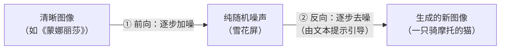

# 第九章 多模态与生成式 AI

> 探索 AI 如何理解和创造图像、音频、视频

---

AI 的能力已经超越了纯文本领域。多模态 AI 能够同时处理文本、图像、音频、视频等多种形式的数据；生成式 AI 则能够创造全新的内容。本章将介绍这些令人兴奋的技术方向。

## 1. 多模态学习

> 真正的智能不应该是个“瞎子”或“聋子”。以前是读天书，现在是看电影。

### 1.1 什么是“多模态”？

其实，我们人类就是天生的 **多模态（Multimodal）** 生物。
*   你看书时，是在处理 **文本**（Text）。
*   你看到红灯停下时，是在处理 **视觉**（Visual）。
*   你听到警报声时，是在处理 **听觉**（Audio）。

以前的 AI 能力比较单一，更像一个“单模态”系统。
*   GPT-3 只能看懂文字，你给它发张图，它一脸懵逼。
*   ImageNet 模型只能看懂图，你问它“这张图好笑在哪里”，它只会冷冷地回答“猫：99%”。

**多模态 AI**，就是把眼睛、耳朵、嘴巴都装到一个脑子上，让它像人一样感受这个花花世界。

### 1.2 对齐：让图和文“牵手”

怎么让 AI 知道“猫”这个字，和“毛茸茸的图片”是一回事？

这就要提到一个神级算法：**CLIP**（OpenAI 2021 年发布）。

它的训练方法简单粗暴：
1.  从网上抓 4 亿张图片和对应的说明文字。
2.  强迫 AI 做“连连看”。
3.  如果 AI 把“狗的图片”和“猫的文字”连在一起，就狠狠惩罚。
4.  如果连对了，就给糖吃。

经过 4 亿次训练，AI 终于顿悟了：原来这种长相的东西叫“狗”。

这样，**图像世界**和**文字世界**就在 AI 的脑子里 **“对齐”** 了。

### 1.3 多模态大模型：看图写作文

现在的大语言模型（LLM），不仅仅是认识“这是猫”。

你给它一张复杂的财务报表截图，它能瞬间把里面的数据读出来，算好账，还顺便给你分析一下公司的经营状况。

你拍一张冰箱里的剩菜，它能识别出有什么食材，然后给你推荐今晚的菜谱。

**它不仅仅在“看”，它在“理解”。**

### 1.4 思考题

现在的 AI 已经能看（视觉）、能听（听觉）、能读（文本）。

你觉得 AI 还需要哪种感官，才能真正理解人类世界？

（提示：为什么当前 AI 仍很难真正理解“妈妈做的红烧肉真好吃”？因为它缺了 **味觉**、**嗅觉**，也缺少人类情感与生活经验。）

## 2. 图像生成与扩散模型

> AI 画画不是在“拼贴素材”，而是在“雕刻噪点”。无中生有，始于噪点。

### 2.1 以前的 AI 画画：像拼贴

在 2022 年之前，AI 主要是靠 **GAN（生成对抗网络）** 画画。

简单说，就是让两个 AI 打架：
*   **骗子（生成器）**：拼命造假画。
*   **警察（判别器）**：拼命抓假画。

打到最后，骗子技艺大涨，连警察都分不清真假了。

但这有个问题：GAN 生成的图，往往细节很假，而且很难控制内容。

### 2.2 现在的 AI 画画：扩散模型

如果将视角拉回技术演进的时间线，扩散模型并非在 2022 年凭空产生。它的学术研究源于更早的奠基：
1. **理论提出**：2015 年左右扩散概念初步诞生，随后在 2020 年的经典论文**DDPM**（Denoising Diffusion Probabilistic Models）中得到了验证，证明了从纯噪声中分步还原出高质量图像的潜力。
2. **算力破局**：在 2021-2022 年间，**潜在扩散模型（LDM，Latent Diffusion Models）** 巧妙地将降噪过程转移到了压缩的“潜在空间”中，大幅缩减了对显卡算力的需求。
3. **产品爆发**：到了 2022 年，基于 LDM 架构的**Stable Diffusion**宣布开源，同时商业工具**Midjourney** 横空出世，正式引爆了整个 AIGC 图像生成的产品生态。

它们用了一种全新的魔法，你可以把它想象成 **“修复文物”** 的过程，但却是倒着来的：
1.  **加噪（破坏）**：把一张《蒙娜丽莎》一点点泼上墨水（噪点），直到它变成一张完全看不清的雪花屏。
2.  **去噪（修复）**：AI 学习这个过程的逆过程。
    *   给它一张雪花屏（随机噪声）。
    *   告诉它：“这就叫 '一只骑摩托的猫' 的雪花屏”。
    *   AI 开始一点点把噪点擦掉。
    *   奇迹发生了！随着噪点消失，一只猫的轮廓浮现出来，然后是毛发，然后是摩托车...

图 9-1：扩散模型的「加噪—去噪」过程。模型在训练时学习加噪的逆过程；生成时便能在文本提示的引导下，从纯随机噪声一步步还原出图像。

### 2.3 为什么 AI 怕画手？

很多人发现，AI 画的脸美若天仙，但手经常是 6 根指头，或者长得像爪子。

这是因为在扩散模型的学习素材里，人脸通常是很清晰、很标准的。

但在照片里，手经常是模糊的、遮挡的、奇形怪状的（拿杯子、插口袋）。

AI 没学明白手的解剖结构，它只是在 **“模仿像素的排列”**。它觉得这里应该有一堆肉色的东西，至于是不是 5 根，它不太在乎。

（注：近两年的新版本在手部细节上已有明显改善，但复杂姿态下仍可能出现失真）。

### 2.4 思考题

AI 生成的画，算不算 **“艺术”**？

如果 AI 学习了梵高所有的画，然后生成了一幅“梵高风格”的新作，那这幅画的 **版权** 应该归谁？

是归开发 AI 的公司？归输入提示词（Prompt）的用户？还是归梵高（的后人）？

这目前是法律界最头疼的问题。

## 3. 视频与音频生成

> 视频与音频生成正在快速进化，但离“全面替代专业制作”还有距离。Suno 懂乐理，而视频生成领域仍在快速迭代。

### 3.1 从 Sora 看视频生成：AI 如何理解物理世界

2024 年初，OpenAI 发布的 **Sora** 曾引发广泛关注，展示了 AI 视频生成在画质和运动连续性上的重大突破。

在此之前，AI 视频画面歪歪扭扭，人走着走着就变成了狗。而 Sora 的样例展现了更好的“物理合理性”：
*   女人走在东京街头，水坑里的倒影是准确的。
*   越野车在土路上跑，扬起的灰尘是真实的。

Sora 不仅仅是在生成像素，它似乎能在一定程度上 **“理解”** 重力、光影、碰撞这些物理规律。

这可以看作 **World Model（世界模型）** 的雏形：先在“脑海里”模拟场景怎么变化，再生成画面。

值得注意的是，OpenAI 官方帮助中心说明 Sora API 将于 2026 年 9 月 24 日停止服务；同时官方开发者文档仍列出 Sora 2 / Sora 2 Pro。对学习者来说，这说明视频生成领域仍在快速洗牌，不应把某一代产品入口当作长期稳定事实。

与此同时，其他重要的视频生成模型也在快速迭代：**Google Veo 3.1 Preview**、**Runway Gen-3/Gen-4**、**Kling** 等各具特色。这些模型的竞争正在推动视频生成从演示走向更可用的创作工具，但具体能力和开放范围要以各厂商官方文档为准。

### 3.2 Suno & Udio：AI 贝多芬

如果说 Sora 让视频生产提速，那 **Suno**和**Udio** 则让音乐创作门槛大幅下降。

你只需要输入：“一首悲伤的中文民谣，关于失恋的程序员，要有点周杰伦的风格”。

几秒钟后，一首完整的、带人声演唱、带编曲的歌就出来了。

有些效果已经达到“可发布 Demo”的水准。

这种技术叫 **Audio Gen（音频生成）**。

它把声波切成了无数个小片段，像预测下一个文字一样，预测下一个音符。

### 3.3 Seedance：电影级的音视频同步生成

2026 年初，字节跳动发布了视频生成模型 **Seedance 2.0**，在业界掀起新一轮讨论。

与 Sora 主要生成“静音视频”不同，Seedance 2.0 的最大亮点是 **原生音视频同步生成**——画面和声音在同一个模型里一起产出，无需后期配音。角色说话时，嘴型、语调、环境音效浑然一体，支持 8 种以上语言的唇形同步。

另一个突破是 **多镜头叙事（Multi-shot Storytelling）**：你只需给出一段剧情描述，模型就能自动拆分成多个镜头，保持角色外貌一致、场景逻辑连贯——有点像一个“AI 导演”在帮你分镜。

不过，Seedance 2.0 也引发了激烈的版权争议。好莱坞的电影协会（MPA）以及迪士尼等公司指控其训练数据中使用了大量受版权保护的影视作品，字节跳动不得不推迟了全球 API 的上线计划。这再次提醒我们：生成能力越强，围绕数据来源和知识产权的法律问题就越紧迫。

### 3.4 未来的娱乐业：交互式内容

试想一下，5 年后，你可能不再看 Netflix 拍好的剧了。

你对电视说：“我想看一部科幻片，主角长得像我，剧情要反转三次，结局要大团圆。”

然后，AI **实时生成** 了一部专属于你的 4K 电影。

这仍是探索中的方向，但技术轨迹已经很清晰：内容会更“可定制、可互动”。

**“Interactive Video”（交互式视频）** 是重要趋势之一。

但要真正普及，还要解决长时一致性、可控编辑、版权授权、内容审核与成本等问题。

所以更现实的判断是：它会先在营销、游戏、教育和短视频创作中逐步落地。

### 3.5 思考题

当 AI 能生成以假乱真的视频和声音（Deepfake），“眼见为实”这句话就不再成立了。

如果有人用 AI 生成了你犯罪的视频，你该如何证明自己的清白？

未来我们是否需要一种 **“反 AI 鉴定技术”** 作为司法取证的标准？

## 4. 原生全模态与具身智能

> 更强的智能体（Agent）往往需要感知、行动和反馈能力。大模型 + 机器人 = 终结者？（开玩笑，是管家）。

### 4.1 原生全模态

早期多模态系统常采用分模块串联：视觉、语音、文本各自处理，再把结果交给语言模型整合。

现在的 **大语言模型（LLM）** 正在逐步走向**原生** 多模态。

就像一个刚出生的婴儿，他不是先学会文字再学会看图，他是 **同时** 在听、看、摸的过程中学习的。

这种模型在处理视频、音频、文字时，通常更少“绕路”（比如不需要先把所有信息都转成文字再处理），所以体验更流畅。

### 4.2 具身智能：AI 有了身体

AI 不能总是活在服务器里。它需要走进物理世界。

这就叫 **“具身智能”**。

想象一下：
*   **大脑**：是云端的大语言模型（LLM），负责思考、规划、理解常识。
*   **身体**：是特斯拉的擎天柱（Optimus）机器人，负责走路、拿杯子、叠衣服。

当大模型赋予机器人“常识”（比如知道玻璃杯掉在地上会碎，所以要轻拿轻放），机器人就不再是只会拧螺丝的傻大个了。

它有潜力在部分家庭与工业场景承担更多任务，但距离“全能家庭保姆”仍有工程与安全门槛。

### 4.3 迈向世界模型

AI 的一个长期目标，是建立更完整的 **世界模型**。

在这个模型里，AI 能够推演未来。
*   它不需要真的把杯子推下去，就能在脑海里模拟出“杯子碎裂”的画面。
*   它不需要真的去撞车，就能模拟出自动驾驶的风险。

学术界对此有诸多探索路线，比如图灵奖得主 Yann LeCun 积极倡导的 **JEPA（联合嵌入预测架构）**，就是让模型像动物和人类一样预测世界如何演变，而不是死磕每个像素点。

如果 AI 能够更稳定地模拟复杂现实世界，我们就可能更接近 **通用人工智能（AGI）**；但这条路径仍有很大不确定性。

### 4.4 思考题

如果未来真的有了全能的家庭机器人，又能做饭又能陪聊，甚至比你的家人更懂你（因为它是大模型，它记得你说的每一句话）。

你会愿意和一个机器人建立深厚的情感联系吗？

人类社会结构会不会因此解体？（比如大家都不结婚了，都和 AI 过日子）
