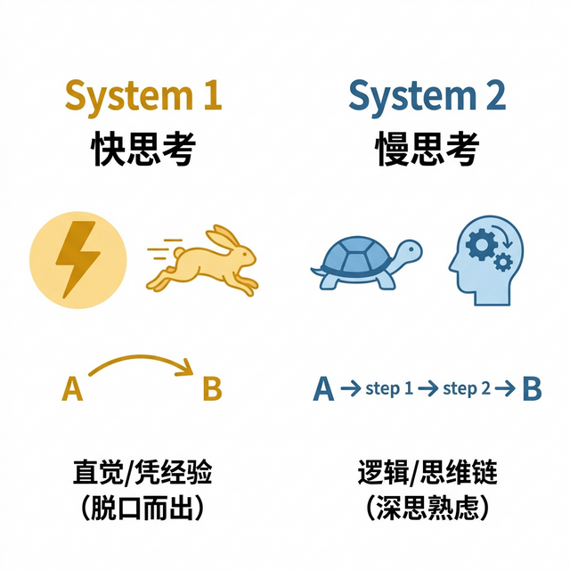
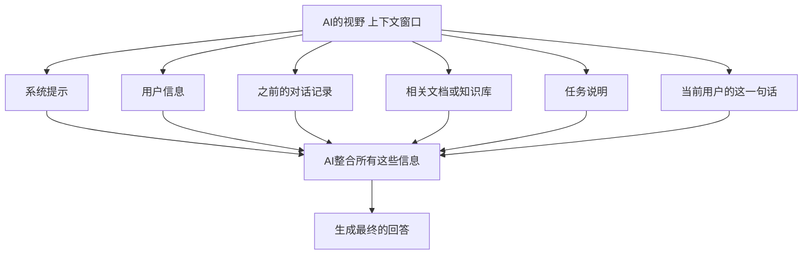
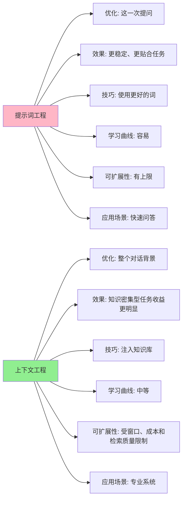

# 第十二章 提示词工程进阶与上下文工程

> 从“会提问”到“会引导”，从优化一句话到优化整个知识背景

---

掌握了基础提示词技巧后，本章将带你进入两个更深层的领域：

**提示词进阶**：如何引导 AI 进行深度思考，用思维链、结构化输出和迭代优化解决复杂任务。

**上下文工程**：提示词只是 AI 看到的“一句话”，上下文工程则优化 AI 看到的“整个背景”——包括 RAG、知识库和 MCP 协议。这是 2026 年 AI 应用的核心能力。

## 1. 思维链

> 结果很可能是凑出来的，过程才是逻辑的体现。Let's think step by step.

### 1.1 为什么 AI 会做错小学数学题？

如果你问 GPT-3 一个这样的问题：
> “小明有 5 个苹果，吃了 2 个，又买了 3 筐，每筐 10 个，现在有几个？”

它可能会直接回一个数字：35。

但如果是更复杂的逻辑题，它很可能会算错，比如算出 30 或者 40。

因为它像个 **心算很快但粗心大意的小学生**，它是凭“直觉”（概率）猜一个数字，而不是真的在算。

### 1.2 一句话，可能显著提升稳定性

怎么样让它变聪明？

只需要加一句咒语：
> **请一步一步地思考（Let's think step by step）。**

> **更稳妥的写法（推荐）**
> 如果你不需要它把“思考过程”写得很长，可以改成：**“请给出可检查的关键步骤/中间结果，并在最后给出答案。”**

一旦你加了这句话，也就是引导它使用 **思维链（CoT）**，它更可能给出类似下面这种“可检查步骤”的回答（不同模型/产品可能会隐藏或简化部分思考过程）：
> 好的。
> 1. 起始有 5 个苹果。
> 2. 吃了 2 个，剩下 5 - 2 = 3 个。
> 3. 买了 3 筐，每筐 10 个，共 3 * 10 = 30 个。
> 4. 总数 = 剩下的 3 个 + 新买的 30 个 = 33 个。
> **答案是 33。**

你看，虽然它可能本来想蒙 35，但一旦被逼着写出了 **计算过程（草稿纸）**，它自己就发现了逻辑链条，从而得出了正确答案。

### 1.3 隐式推理 vs 显式推理

近年的一些“更擅长推理”的模型与产品形态，已经把部分思维链能力内化了。你在界面上可能会看到它在“思考中...”。

这叫 **慢思考（System 2 Thinking）**。
*   **快思考（System 1）**：脱口而出，凭直觉，容易错。
*   **慢思考（System 2）**：深思熟虑，有逻辑，更准确。



图 12-1：快思考（System 1）与 慢思考（System 2）对比

当我们面对复杂任务（如写代码、做策划、算账）时，可以主动引导 AI 给出可检查的关键步骤，再由你复核结果。

### 1.4 思考题

在工作中，你向老板汇报时，是直接给结论（System 1），还是展示你的推导过程（System 2）？

哪种方式更有说服力？

其实，AI 和老板一样，都喜欢看 **路书**。

## 2. 结构化输出

> 别让 AI 写作文，让它“填表”。请使用 Markdown 表格/JSON 格式输出。

### 2.1 AI 天生爱唠叨

如果你问 AI：“这是哪三款手机的对比？”

它通常会给你写一篇像博客一样的长文：
> “好的，这三款手机分别是 A、B 和 C。A 的特点是像素高，屏幕大... 而 B 的续航很好，但是有点重... C 则是...”

看着很累，重点难找，复制粘贴也很麻烦。

这是因为 AI 默认是在 **“聊天”（Chat）**，而不是在 **“处理数据”（Data Processing）**。

### 2.2 驾驭 AI 的缰绳：格式限制

对付“话痨”最好的办法，就是直接扔给它一个 **“框”**。

我们不仅要告诉它 **“内容是什么”**，还要规定它 **“长什么样”**。

#### 场景 1：做竞品分析（使用表格）

> “请对比 iPhone 15 和 Pixel 8。
> **请使用 Markdown 表格形式输出**，包含以下列：型号、屏幕尺寸、处理器、价格、核心卖点。”

结果瞬间清爽：
| 型号 | 屏幕尺寸 | 处理器 | 价格 | 核心卖点 |
| :--- | :--- | :--- | :--- | :--- |
| iPhone 15 | 6.1 寸 | A16 | $799 | 生态系统、视频拍摄 |
| Pixel 8 | 6.2 寸 | Tensor G3 | $699 | AI 拍照功能、原生安卓 |

#### 场景 2：程序员写代码（使用 JSON）

> “帮我提取这段新闻里的人物、地点和时间。
> **不要废话，直接输出 JSON 格式**，字段为：`person`, `location`, `time`。”

结果直接可用：
```json
{
  "person": "Sam Altman",
  "location": "San Francisco",
  "time": "2023-11-17"
}
```

### 2.3 为什么要结构化？

结构化输出不仅仅是为了好看，它有两个巨大的价值：
1.  **可读性（Readability）**：信息密度极大提升，一目了然。
2.  **可连接性（Connectivity）**：结构化的数据（如 JSON/CSV）可以直接被 Excel、代码或其他软件读取。这时，AI 就不再只是一个聊天机器人，而变成了一个**数据预处理器**。

> [!NOTE]
> **API 级别的强校验 (JSON Schema)**
>
> 如果仅依靠“请输出 JSON”的自然语言提示，模型在复杂场景下依然可能输出错误格式（例如少了个逗号、或多废话几句代码注释）。在工业级生产环境中，我们不仅要求输出格式，还需要进行 **机器强约束与校验**：
> 1. **Structured Outputs / Function Calling**：现代模型 API（如 OpenAI 的 Structured Outputs）支持直接在发送 API 请求时附带 `JSON Schema`（数据结构定义），通过引擎底层甚至是生成采样过程（Sampling）强迫其 100%符合结构。
> 2. **本地校验阻断**：即使收到了 JSON 内容，也要利用代码库（如 Pydantic 或 jsonschema）直接验证拦截。一旦失败立刻抛弃或交回模型自动重试。
>
> **代码实验**：
> 请参阅本书配套的 [`labs/02_structured_output.py`](../labs/02_structured_output.py)。其中展现了如何**只用标准库 `json.loads` 加显式字段校验**（生产环境可换成 `jsonschema` 或 Pydantic）对 AI 生成的 JSON 数据格式执行本地化严谨校验并捕捉错误。

### 2.4 思考题

回想一下你最近一次让 AI 帮你做总结。

如果当时你加上一句 **“请用列表形式展示核心观点”** 或者 **“请生成一个思维导图格式（Markdown）”**，效果会不会好很多？

下次试试看。

## 3. 迭代优化

> 没有一气呵成的神作，只有不断修改的初稿。先跑通，再优化。

### 3.1 第一版通常都是垃圾

海明威说过：“一切初稿都是狗屎（The first draft of anything is shit）。”

提示词也是一样。

当你写下第一句 “帮我写个文案” 时，得到的通常是平庸的回答。

但这没关系。**重点在于迭代**。

### 3.2 像产品经理一样改需求

我们来看一个 **V1 -> V3** 的进化过程。

任务：卖一款“静音加湿器”。

*   **V1（小白版）**：
    > “写个加湿器文案。”
    > *结果：像产品说明书。*

*   **V2（进阶版 - 加需求）**：
    > “太干巴了。要针对 **宝妈**群体，突出**静音**，语气要**温暖**。”
    > *结果：好多了，但有点啰嗦，像流水账。*

*   **V3（高手版 - 加格式和限制）**：
    > “很好。现在请把这篇文案精简成 3 个卖点。
    > 格式要求：**Emoji + 4 字短标题 + 20 字以内的痛点描述**。
    > 只要这三行，其他废话不要。”
    > *结果：完美的朋友圈文案。*

看，你不需要一次性把 V3 写出来。

你可以像挤牙膏一样，看着 AI 的输出，一点点 **把它的方向掰回来**。

### 3.3 用魔法打败魔法：让 AI 写提示词

如果你实在不知道怎么优化，可以 **向 AI 求助**。
> “我想让你扮演一个[什么角色]来做[什么事]。
> 我现在的提示词是：'......'。
> 请帮我 **优化这个提示词**，让它更清晰、更结构化，能产生更好的结果。”

AI 会像个老教授一样，帮你把那句大白话改成一段逻辑严密的指令代码。

然后你把这段新指令发给它，效果直接起飞。

### 3.4 思考题

在软件开发中，我们讲究 “敏捷开发，快速迭代”。

在写提示词时，你是倾向于憋半小时写一个完美的超长提示词（Mega Prompt），还是先花 10 秒写个大概，然后通过 5 轮对话慢慢调？

对于大多数非程序员来说，**后者（对话式微调）** 通常效率更高。

## 4. 高级提示词技巧

> 把 AI 玩出花来，让它不仅仅是个问答机器。让它考你，而不是你考它。

### 4.1 费曼学习法：角色反转

通常是我们问，AI 答。

但在学习新知识时，反过来效果更好。

**提示词**：
> 我想练习雅思口语。
> **请你扮演严厉的考官，我是考生**。
> 你问我一个问题，等待我回答。
> 我回答后，请点评我的语法错误，并给出更高分的表达方式。
> 然后再问下一个问题。

这时候，AI 就变成了你的 **私教**。它可以陪你练英语、模拟面试、甚至模拟吵架。

这比你看 100 篇“雅思技巧”文章都要管用。

### 4.2 三个诸葛亮：自洽性

对于特别难的逻辑题，可以让 AI “分身”。

**提示词**：
> 请思考这个问题，给出 3 种可能的解法。
> 然后比较这 3 种解法，看看哪种最合理。
> 最后输出一个你认为最正确的结论。

这叫 **思维链自洽性（CoT-SC）**。

你可以把它理解成“让 AI 先独立想 3 遍，再选最一致的答案”，这样往往更容易过滤掉不靠谱的回答。

### 4.3 强化约束：把验收标准写清楚

比起“哄”模型，更稳定的方法是把任务优先级和验收标准写清楚。

你可以这样写：
> “这份内容用于正式对外发布，请按最高准确性标准处理。”
> “请先给出 3 个候选方案，再按【准确性、完整性、可执行性】逐项自评，最后输出你认为最稳妥的一版。”

这种写法的本质是把“你到底要什么”说清楚，让模型在生成过程中主动做一轮质量检查。
**对待 AI，最有效的技巧通常不是“情绪刺激”，而是“明确目标 + 明确约束 + 明确验收”。**

### 4.4 思考题

本章我们学了很多“术”（思维链、迭代、角色反转）。

但“道”是什么？
**“道”就是把 AI 当作人。**
你越尊重它的逻辑规律（Chain of Thought），越懂得如何给它反馈（Iterative），它给你的回报就越惊人。

## 5. 上下文工程：AI 时代的基本素养

> 同样的问题，不同的上下文，AI 给出完全不同的答案

### 5.1 一个真实的例子

想象你问 ChatGPT：“推荐一部电影”。

AI 的回答可能很普通：《肖申克的救赎》、《楚门的世界》之类。

但如果你告诉 AI：
- “我的工作是医生，每天都很疲惫”
- “我喜欢看需要大脑思考的电影”
- “我不喜欢暴力镜头”
- “我最近看了《盗梦空间》和《记忆碎片》”
- “我的假期只有 3 小时”

突然，AI 给出的推荐就完全不同：《心灵捕手》（有医学背景，需要思考，平静）、《时间规划局》（需要思考，适合短时间观看）。

这两个例子中，**提示词只是“推荐一部电影”**，但**上下文** 完全不同，所以答案也不同。

### 5.2 什么是上下文？

上下文（Context）= AI 做决定时能看到的所有信息



关键洞察：
- 当前的一句话（提示词）其实占比很小
- AI 真正看重的是整个背景信息

> 💡 关于上下文工程的完整介绍，请参阅《上下文工程指南》。

### 5.3 为什么上下文工程这么重要？

#### 理由 1：人类也是这样工作的

想象你去看医生：

情景 A：医生什么都不知道，只听你说“我很累”
- 医生会很困惑
- 可能建议：多休息
- 判断只能停留在很粗的层面

情景 B：医生知道你的完整医疗史、工作压力、生活方式
- 医生能做出准确判断
- 可能发现潜在疾病
- 更容易提出贴合你情况的判断

**同样的问题，上下文的差异决定了答案的质量。** AI 也是如此。

#### 理由 2：AI 的关键限制是上下文窗口

不同 AI 模型的上下文窗口大小差异很大。这个窗口大小决定了你能一次性喂给 AI 的信息量。必须精心设计这个有限的上下文，让 AI 在这个限制下做出最好的决定。

### 5.4 上下文的三个层次

#### 第一层：对话上下文

```text
最简单的上下文：之前的对话记录

你：3乘以5是多少？
AI：15

你：再乘以2？
AI：30（理解了"再"指的是上一个结果）

如果没有对话上下文，AI就不理解你的"再"。
```

这是现有 AI 工具都支持的。

#### 第二层：知识库上下文

```text
把你的知识喂给AI

你的公司手册 → 向量数据库 → AI在回答时搜索相关部分 → AI基于这些部分回答

例子：
用户问："我们的休假政策是什么？"

没有RAG：AI可能说"我不知道"或基于通用知识瞎说

有RAG：
1. 搜索公司手册中"休假"相关的部分
2. 找到："员工每年享受20天带薪假期"
3. AI精确回答

结果：答案从"不知道"变成"精确回答"
```

#### 第三层：系统集成上下文

```text
让AI实时访问外部系统

没有MCP：
用户："我的日历有什么安排？"
AI："我看不到你的日历"

有MCP（Model Context Protocol）：
用户："我的日历有什么安排？"
AI：[调用MCP接口] → [查询Google Calendar]
    → "你下午3点有个与张三的会议"

AI不再是"知道"的东西，而是能"看到"实时信息
```

### 5.5 上下文 vs 提示词：根本区别



### 5.6 实际效果对比

#### 例子 1：代码生成

**只用提示词：**
```text
提示词："用Python写一个快速排序"

结果：获得教科书级的通用快速排序
问题：
- 不符合你的代码风格
- 不包含你项目的特定需求
- 需要大量修改
```

**用上下文工程：**
```text
上下文：
1. 系统提示："你是我的代码助手，熟悉我的项目风格"
2. 我的编码规范（15行）
3. 我项目的现有代码（200行）
4. 这个函数需要与之集成的代码

提示词："用Python写一个快速排序"

结果：生成的代码
- 符合我的风格
- 完美集成到项目中
- 基本不需要修改
```

效果差异：只给一句提示词时，后续往往需要较多返工；补充项目上下文后，返工通常集中在细节调整和人工验收。

#### 例子 2：论文写作助手

**没有上下文：**
```text
用户："帮我写一篇关于AI的论文"
AI："AI是...（很通用的内容）"
```

**有上下文：**
```text
上下文：
1. 论文的标题和摘要
2. 已有的研究背景（3页）
3. 期刊的格式要求
4. 你以前写过的2篇论文（作为写作风格参考）
5. 相关的研究文献列表

提示词："帮我完成第3章"

结果：
- 风格与你之前的论文一致
- 引用格式正确
- 深度和专业性符合期刊要求
- 逻辑与前面章节连贯
```

#### 例子 3：客服机器人与知识库

**没有上下文的客服 AI：**
```text
用户："我的订单为什么还没发货？"
AI："您可以到订单页面查看物流信息..."（通用回答）

问题：
- 不知道用户的订单状态
- 不知道公司的配送政策
- 不知道当前是否有库存问题
- 可能无法解决用户的实际问题
```

**有 RAG 上下文的客服 AI：**
```text
上下文：
1. 用户账号的订单历史和详细信息
2. 当前订单的物流跟踪数据（实时）
3. 公司常见问题库和配送政策文档
4. 当前库存和发货状态
5. 用户之前的投诉和解决方案

提示词："我的订单为什么还没发货？"

AI的实际回答：
"您的订单（编号#12345）已于1月15日确认。
由于2024年末高峰期，当前配送周期为7-10个工作日。
预计发货时间：1月20日。
如需加急，我们提供次日达服务（额外$5）。
您之前对订单#11234也等待过发货，那一次最终提前1天到达。"

效果：具体、有针对性、能解决问题
```

#### 例子 4：法律文档分析助手

**没有上下文：**
```text
用户："这份合同对我有利吗？"
AI给出通用的法律建议，可能不适用于你的具体情况

问题：
- 不知道法律管辖地
- 不知道行业背景
- 不知道你的具体权益
- 可能给出有风险的建议
```

**有上下文的法律助手：**
```text
上下文：
1. 用户的行业背景和业务模式
2. 适用的法律框架（所在国家/地区）
3. 用户之前签过的类似合同及其教训
4. 行业的标准合同条款
5. 用户的优先级和风险承受度

提示词："这份合同对我有利吗？"

AI的分析：
"基于你的SaaS创业背景和中国管辖：

✓ 有利的条款：
- 知识产权归属明确
- 赔偿责任有限制

✗ 风险条款：
- 第3.2条：'甲方可随时修改服务条款'
  → 对标准的条款应该是'30天预告后修改'

- 第5.1条：'乙方需提供无限技术支持'
  → 根据你以前的合同，应该限制为'工作时间内'

🔧 建议修改：
1. 在第3.2条添加'30天预告期'
2. 在第5.1条添加'每月200小时上限'
..."

效果：专业、细致、有可执行的建议
```

#### 例子 5：编程助手与代码库上下文

**没有上下文：**
```text
用户："帮我写一个API接口"
AI："这是一个通用的REST API示例..."

问题：
- 不知道你的技术栈
- 不知道你的代码风格
- 不知道已有的项目结构
- 生成的代码可能无法直接用
```

**有上下文的编程助手（MCP 集成）：**
```text
上下文：
1. 你的项目代码库（获取当前的架构）
2. 项目的技术栈和依赖列表
3. 你的编码规范文档
4. 已有的相似功能代码
5. 项目的数据库Schema

提示词："帮我写一个用户认证API"

AI的代码生成：
- 自动使用你项目的框架（如FastAPI）
- 遵循你的命名规范和文件组织
- 与现有的数据库Schema兼容
- 集成到你的错误处理系统
- 包含与你项目一致的日志和监控

结果：生成的代码开箱即用，基本不需要修改
```

### 5.7 成本与权衡

上下文工程的成本：

```text
向量数据库成本：
- 小规模原型：可能落在免费层或开发者层，但会受存储、请求量、索引数等限制
- 托管生产环境：通常包含月度最低消费或用量计费，具体以 Pinecone、Weaviate、Zilliz 等厂商价格页为准
- 大规模或合规部署：通常需要专用集群、私有网络、备份和支持合同

API成本：
- 提示词工程：消耗较少token（提示词短）
- 上下文工程：消耗更多token（上下文长）

权衡：
上下文越长，token、检索和维护成本通常越高；效果是否提升，需要用准确率、召回率、返工率或人工验收来衡量

ROI分析：
如果你的工作高度依赖专有知识，先做小规模试点，再决定是否投入完整系统
```

### 5.8 谁应该学习上下文工程？

#### 必须学：

1. **AI 产品经理**：决定产品的上下文架构
2. **AI 工程师**：构建 RAG 和 MCP 系统
3. **知识工作者**：需要 AI 辅助的专业人士

#### 应该学：

1. **管理者**：了解 AI 的真实能力
2. **学生**：为 2030 年做准备

### 5.9 本部分的学习路线

```text
第12.5节（当前）：上下文工程概念
   ↓
本节 12.5.4：上下文的三个层次（含RAG）
   ├─ 第二层：知识库上下文
   ├─ 向量与相似性搜索
   └─ 实际的RAG系统设计

第十四章：AI 智能体与多智能体系统
   ├─ 14.1-14.2 智能体感知、规划与行动（含 MCP 协议）
   ├─ 14.3 低代码智能体开发平台（Coze、Dify 等）
   └─ 14.4 多智能体协作系统
```

### 5.10 与其他章节的联系

📖 **延伸阅读**：
- 想深入学习提示词工程的基础？请参阅《第十章 主流 AI 工具使用指南》与《第十一章 提示词工程入门》
- 想了解多智能体如何协作？请参阅《第十四章 AI 智能体与多智能体系统》中的 14.4 多智能体协作系统，其中上下文工程对多智能体间的通信很重要
- 量子计算为什么短期不应作为上下文/RAG 搜索方案依赖？请参阅《第十六章 AI 硬件与量子计算入门》中关于优化问题局限的部分

### 5.11 关键要点总结

1. **上下文 > 提示词**
   - 同样的提示词，不同的上下文，答案可能完全不同
   - 提示词值得优化，但在知识密集型任务里，仅优化提示词通常不够

2. **三层上下文**
   - 对话历史（所有 AI 工具都有）
   - 知识库（通过 RAG 实现）
   - 系统集成（通过 MCP 实现）

3. **这是未来**
   - 提示词工程仍有价值，但上下文工程更接近真实 AI 应用系统的工作方式
   - 能把知识库、工具和验收标准组织清楚的人，会更容易做出可靠的 AI 工作流

### 5.12 思考题

1. 你现在使用 AI 的方式中，什么地方可以通过上下文工程大幅改进？

2. 如果你有机会给 AI 注入 10KB 的额外上下文，你会注入什么信息？

3. 你能想到什么场景，其中 MCP 的实时系统集成会改变游戏规则？
