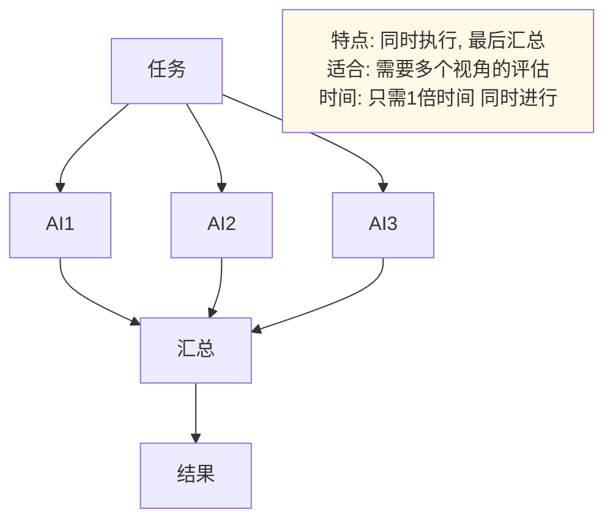
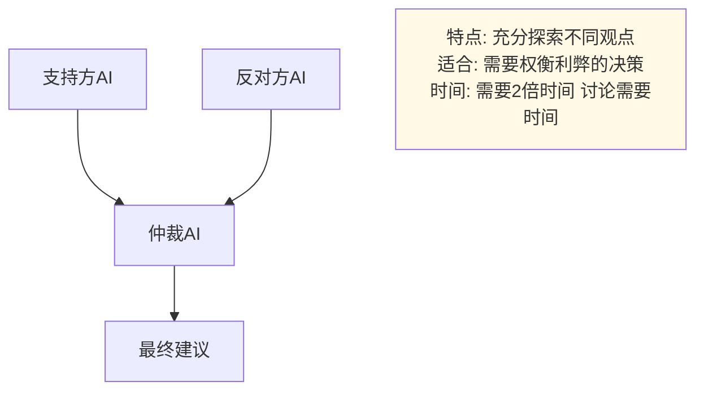
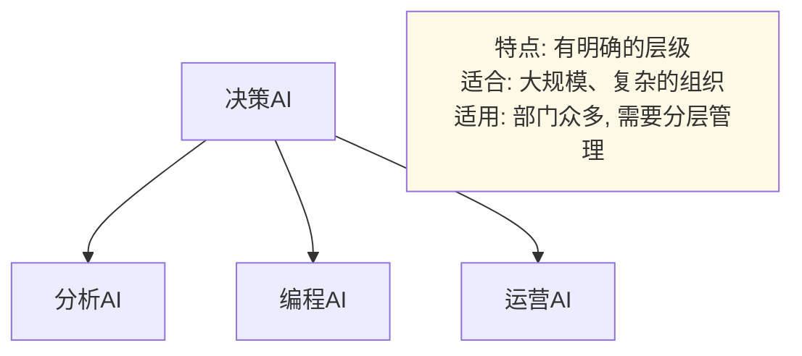

# 第十七章 全书总结

## 第一章 走进人工智能世界

## 本章小结

本章带领读者走进了人工智能的世界，从基础概念到发展历程，从分类体系到应用场景，建立了对 AI 的整体认知框架。

### 核心要点回顾

**什么是人工智能**
- AI 是使机器能够模拟人类认知功能的技术，包括学习、推理、问题解决、感知等能力
- 与传统软件不同，AI 从数据中学习规则，而非由程序员预先定义
- 当前的 AI 系统具备感知、学习、推理、决策和生成等核心能力

**AI 的发展历程**
- 1956 年达特茅斯会议标志着 AI 作为独立学科的诞生
- AI 发展经历了多次繁荣与寒冬的交替循环
- 2012 年深度学习革命开启了 AI 发展的新纪元
- 2022 年起，生成式 AI 进入公众视野，标志着新时代的到来

**AI 的分类体系**
- 按能力水平：弱人工智能（当前所有 AI）→ 强人工智能（未实现）→ 超级人工智能（假设）
- 按学习方式：基于规则、机器学习、深度学习
- 按功能领域：计算机视觉、自然语言处理、语音技术、推荐系统、决策智能
- 按任务类型：判别式 AI（分类和预测）vs 生成式 AI（创造内容）

**AI 的应用领域**
- 日常生活：智能手机、语音助手、智能家居、个性化推荐
- 专业领域：医疗诊断、金融风控、自动驾驶、智能制造
- 创意产业：文本生成、图像创作、音乐制作、视频生成

### 延伸思考

1. 当前的 AI 系统是否真正“理解”它们处理的内容？还是只是在做复杂的模式匹配？

2. 如果强人工智能（AGI）真的实现，人类社会将发生怎样的变化？

3. 在 AI 日益普及的背景下，哪些人类能力将变得更加重要？

### 下章预告

在了解 AI 的基本概念和应用场景后，下一章将深入探讨 AI 的核心概念，帮助读者理解人工智能、机器学习、深度学习之间的关系，以及支撑 AI 运行的数据、算法和训练等关键要素。

---

> 📝 **发现错误或有改进建议？** 欢迎提交 [Issue](https://github.com/yeasy/ai_beginner_guide/issues) 或 [PR](https://github.com/yeasy/ai_beginner_guide/pulls)。

## 第二章 AI 核心概念速览

## 本章小结

本章系统介绍了 AI 领域的核心概念，帮助读者建立了扎实的概念基础。

### 核心要点回顾

**AI、机器学习与深度学习的关系**
- 三者是包含关系：AI ⊃ 机器学习 ⊃ 深度学习
- AI 是追求让机器表现智能的广泛愿景
- 机器学习是实现 AI 的主要手段，通过数据学习规律
- 深度学习使用多层神经网络，能自动提取特征，在超大规模数据下持续获益

**数据：AI 的燃料**
- 高质量数据和合适算法同等关键，但数据质量往往决定上限
- 数据是 AI 时代的核心资产，堪比“石油”
- GIGO（垃圾进，垃圾出）：劣质数据会导致模型输出错误
- 数据标注成本高昂，合成数据成为新趋势

**算法与模型**
- 算法是“菜谱”（通用方法），模型是“炒好的菜”（具体成果）
- Transformer 是算法，GPT 系列是模型
- 深度学习模型是“黑盒”，连科学家也难以解释内部逻辑

**训练与推理**
- 训练就是反复做题并订正，通过损失函数衡量偏差
- 训练的核心优化目标是让损失降到最低
- 推理是使用训练好的模型进行预测，成本远低于训练

### 延伸思考

1. 为什么深度学习需要大量数据才能发挥优势？数据量不足时有什么替代方案？

2. AI 模型的“黑盒”特性，对金融风控和医疗诊断等领域会带来哪些风险？

3. 模型越大越好吗？大模型和小模型各有什么优缺点？

### 下章预告

下一章将介绍 AI 技术的生态系统，包括主流的 AI 平台、开源框架、以及云端和边缘 AI 的发展趋势，帮助读者了解 AI 技术的实践环境和工具选择。
---

> 📝 **发现错误或有改进建议？** 欢迎提交 [Issue](https://github.com/yeasy/ai_beginner_guide/issues) 或 [PR](https://github.com/yeasy/ai_beginner_guide/pulls)。

## 第三章 AI 技术生态与工具全景

## 本章小结

本章全面介绍了 AI 技术的生态系统，帮助读者了解从硬件到应用的完整技术栈、主流平台和服务、开源工具，以及部署架构的选择。

### 核心要点回顾

**AI 技术栈的层次**
- 芯片层（GPU）：门槛最高，NVIDIA 一家独大
- 基础设施层（云平台）：提供算力和服务
- 框架层（PyTorch 等）：开发者用来“画图纸”的工具
- 应用层：面向用户的产品和服务

**主流 AI 平台与服务**
- 微软 Azure：企业集成与治理导向
- Google Cloud：模型与数据产品一体化
- AWS：多模型与基础设施深耕
- 选择平台应按约束条件（合规、技术、组织）而非单纯“谁最强”

**开源框架与工具**
- PyTorch 在研究和开源社区占比最高
- TensorFlow 生态成熟，部署工具链完整
- JAX 在前沿研究和高性能训练场景活跃
- Hugging Face 是 AI 界的“GitHub”，大幅降低试错成本
- AI 编程助手（Copilot、Cursor 等）正推动 Agentic Coding

**云端 AI 与边缘 AI**
- 云端：算力强、模型大，但依赖网络、有隐私顾虑
- 边缘：低延迟、保护隐私，但受设备限制
- 未来趋势是混合架构，日常简单任务在端侧，复杂任务上云

### 延伸思考

1. 随着端侧 AI 能力增强，云端 AI 服务商的商业模式会如何变化？

2. 开源模型与闭源模型的竞争格局会如何演变？

3. 对于一个新的 AI 项目，应该如何选择技术栈和部署架构？

### 下章预告

到了这里，我们已经参观完了 AI 的“工具间”和“厨房”。

你可能不禁要问：这些厉害的工具背后，到底藏着什么原理？为什么显卡能算出智能？

接下来，让我们推开 **“核心技术”** 的大门，去探寻 AI 大脑深处的秘密。下一章：机器学习原理。
---

> 📝 **发现错误或有改进建议？** 欢迎提交 [Issue](https://github.com/yeasy/ai_beginner_guide/issues) 或 [PR](https://github.com/yeasy/ai_beginner_guide/pulls)。

## 第四章 机器学习原理

## 本章小结

本章深入介绍了机器学习的核心原理和四大学习范式，帮助读者理解 AI 系统“学习”的本质。

### 核心要点回顾

**机器学习的核心思想**
- 机器学习本质上是一种“归纳法”，从历史数据中总结规律
- 归纳法很强大，但永远无法获得绝对真理（“罗素的火鸡”）
- 四大门派：监督学习、无监督学习、强化学习、自监督学习

**监督学习**
- 使用带标签的数据进行训练，本质是“填鸭式教育”
- 分类问题（做选择题）vs 回归问题（做填空题）
- 最大瓶颈：高质量标签数据的获取成本极高

**无监督学习**
- 处理无标签数据，在没有“标准答案”的情况下发现规律
- 三大法宝：聚类（“物以类聚”）、降维（“把书读薄”）和异常检测（“从寻常中发现不寻常”）

**强化学习**
- 智能体通过与环境交互，靠“奖励”和“惩罚”来学习
- 延迟满足（Delayed Reward）是最大难点
- RLHF 让大模型学会了“说人话”，是 ChatGPT 成功的关键

**自监督学习**
- 介于监督与无监督之间，数据本身即标签
- 核心机制：掩码（挖空）与预测（填空），类似“完形填空”
- 把海量无标注的互联网文本变成了训练“金矿”
- 是 GPT（文字接龙）和 BERT（完形填空）预训练的基础

### 四大范式对比

| 范式 | 数据 | 学习方式 | 典型应用 |
|------|------|----------|----------|
| 监督学习 | 带标签 | 从示例学习 | 分类、回归 |
| 无监督学习 | 无标签 | 发现模式 | 聚类、降维 |
| 强化学习 | 交互产生 | 试错学习 | 游戏、控制 |
| 自监督学习 | 原始数据 | 自我预测 | 语言模型、预训练 |

### 延伸思考

1. 既然机器学习（归纳法）注定无法完全准确地预测未来，我们为什么还敢让 AI 做自动驾驶？

2. 强化学习在游戏中取得了巨大成功，为什么在商业应用中仍相对有限？

3. 自监督学习是如何降低对标注数据依赖的？这对 AI 发展有什么影响？

### 下章预告

下一章将深入探讨深度学习，解析神经网络的工作原理，介绍关键的深度学习技术，以及主流的网络架构（如 CNN、RNN、Transformer），让读者理解当今最先进 AI 系统的技术核心。

---

> 📝 **发现错误或有改进建议？** 欢迎提交 [Issue](https://github.com/yeasy/ai_beginner_guide/issues) 或 [PR](https://github.com/yeasy/ai_beginner_guide/pulls)。

## 第五章 深度学习揭秘

## 本章小结

本章深入解析了深度学习的核心原理，从神经网络基础到关键技术，再到主流架构和实践挑战。

### 核心要点回顾

**神经网络基础**
- 人工神经元模拟生物神经元：接收数字 -> 加权求和 -> 激活函数 -> 传递结果
- “深度”就是网络的层数，每一层把信息进行一次抽象
- 激活函数（如 ReLU）引入非线性，让网络能模拟复杂事物
- 亿万个简单神经元连接起来，可以产生“涌现”现象

**深度学习训练**
- 梯度下降：在“黑夜里下山”，沿着下坡方向更新参数
- 学习率：步子太大会震荡，步子太小会太慢，最佳策略是“先快后慢”
- 局部最优陷阱：SGD 和 Adam 等方法通过加“惯性”来跳出小坑

**主流架构**
- CNN（卷积神经网络）：计算机的“眼睛”，专为图像而生
- RNN（循环神经网络）：计算机的“耳朵”，用于序列数据，但记性不好
- Transformer：全能的“大脑”，用注意力机制“一目十行”，是当前的大一统架构

**深度学习的局限性**
- 黑盒问题：无法解释内部推理过程，对关键领域是合规风险
- 能耗问题：训练顶级大模型需要极高电力和算力成本
- 数据饥渴：对海量高质量标注数据极度依赖
- 灾难性遗忘：学习新任务时容易遗忘旧知识
- 幻觉问题：AI 会一本正经地编造假答案

### 下章预告

下一章将专门介绍大语言模型（LLM），深入解析 ChatGPT、Claude 等模型背后的技术原理，从 Transformer 架构到预训练与微调方法，帮助读者理解生成式 AI 的核心技术。

---

> 📝 **发现错误或有改进建议？** 欢迎提交 [Issue](https://github.com/yeasy/ai_beginner_guide/issues) 或 [PR](https://github.com/yeasy/ai_beginner_guide/pulls)。

## 第六章 大语言模型详解

## 本章小结

本章深入解析了大语言模型的技术原理，从历史演进到核心机制，再到训练方法和主流模型。

### 核心要点回顾

**技术演进**
- 远古时代：Eliza（1966）靠 If/Else 套公式
- 统计时代：Siri（2011）靠统计学“查表”
- 大模型时代：GPT（2018-）靠大规模预训练实现质的飞跃

**工作原理**
- LLM 的核心任务是预测下一个 Token（Next Token Prediction）
- Token 是分词器切出来的子词片段，不等于一个字或一个词
- 温度参数控制输出随机性：低温严谨，高温创意

**训练范式**
- 预训练（“上大学”）：在海量数据上学习语言和知识，极其昂贵
- 微调 SFT（“岗前培训”）：用问答对教它遵循指令，成本较低
- RLHF（“实习”）：通过人类偏好排序对齐人类价值观
- 落地捷径：RAG（检索增强）、工具调用、工作流编排，通常比微调更快

**主流模型**
- 闭源三巨头：OpenAI（GPT）、Anthropic（Claude）、Google（Gemini）
- 开源生态：LLaMA、Qwen、Mistral、Gemma 等多条路线
- 国内竞争激烈：通义千问、文心、DeepSeek、Kimi 各有所长

**工程落地（推理机制）**
- **推理（Inference）**：让大模型在云端跑起来的过程，极度依赖显存带宽和分布式网络。
- **算力 vs 显存**：长文阅读阶段吃算力，逐字生成阶段吃显存和带宽。
- **KV Cache**：大模型的“记事本”，极度消耗显存限制并发数。

### 下章预告

下一章将介绍推理模型与推理计算，探讨模型如何通过显式思考、搜索、工具调用和更长计算预算解决复杂问题。

---

> 📝 **发现错误或有改进建议？** 欢迎提交 [Issue](https://github.com/yeasy/ai_beginner_guide/issues) 或 [PR](https://github.com/yeasy/ai_beginner_guide/pulls)。

## 第七章 推理模型与推理计算

## 本章小结

## 本章核心概念回顾

模型名称、可用性与 thinking 支持矩阵以快变事实核验表为准。

### 主要观点

1. **从 System 1 到 System 2**
   - 传统 LLM 类似人的 System 1（快速直觉）
   - 推理模型融入 System 2（深入思考）
   - 大脑的两套思维系统启示了 AI 的发展方向

2. **推理模型的工作原理**
   - 通过更强的回答前推理改进了传统 LLM
   - 在部分产品里，用户还能看到思路摘要、步骤说明或中间验证
   - 四条代表性路线采用不同的技术方案（强化学习、内部状态管理、RL + 蒸馏、搜索整合）

3. **推理计算（Inference-Time Compute）**
   - 新的 AI 范式：从“训练时投入+推理时快速查表”转变
   - 到“训练时学基础+推理时深入思考”
   - 不同问题可以根据复杂度动态分配推理资源

4. **四大推理模型对比**
   - **OpenAI 推理路线（当前首推 GPT-6 Astra、GPT-6.1 Sol 与 GPT-6 Luna，GPT-5.6 系列与 GPT-5.5 仍可用）**：逻辑和代码能力强，支持推理和基础模型两条路线
   - **Claude thinking 路线**：Claude Fable 5.1、Opus 5.5 与 **Claude Sonnet 5.5** 使用 Adaptive Thinking，Haiku 4.5 使用 Extended Thinking；Fable 5.1 广泛可用，Mythos 5.1 为受限可用
   - **DeepSeek-R1（2025-01-20）**：经济的工程师，成本最低，可本地部署
   - **Gemini（Deep Research 模式）**：知识的聚合家，擅长研究型信息整合

5. **推理模型的局限与成本**
   - 时间成本通常更高（从几秒到更久）
   - 知识局限仍然存在（只能组织已知，不能凭空创造事实）
   - 成本是否显著升高，取决于模型、缓存命中率与具体任务
   - 不适合所有创意和实时任务
   - 可能过度思考而浪费资源

## 核心概念术语表

| 术语 | 定义 |
|------|------|
| System 1 | 快速、自动化、不需费力的思维方式 |
| System 2 | 缓慢、需集中力、深入思考的思维方式 |
| 思维链（CoT） | 让模型显式地写出推理步骤 |
| 推理计算 | 在用户提问时分配计算资源进行推理 |
| 推理 token（思考 token） | 用于思考而非最终输出的 token，按输出 token 计费 |
| 思考预算（Thinking Budget） | 控制模型在回答前最多可用多少推理 token |
| Adaptive Thinking | Claude Fable 5.1 与 Opus 5.5（常开）、Claude Sonnet 5.5 等新一代型号使用的推理模式；具体支持矩阵以快变事实核验表为准 |
| 知识蒸馏 | 将大模型的能力压缩到小模型中 |
| 多路径探索 | 推理过程中尝试多个方法并选择最优 |

## 重要数字和对比

```text
更稳妥的理解方式：

- **速度**：推理模型通常更慢，但不是所有问题都会慢到同一数量级
- **成本**：是否更贵取决于厂商定价、是否启用推理模式、缓存命中率和输出长度
- **准确度**：在复杂数学、代码、规划任务上往往更强，但在简单查询上未必值得
- **适用场景**：传统模型覆盖更多日常交互，推理模型更适合高价值复杂问题
```

## 学习要点

### 新手必须理解的

1. **推理模型不是“更好的 LLM”，而是“不同的 LLM”**
   - 它不是所有任务都优越的升级版
   - 而是在特定问题上专业化的变体

2. **时间和成本是关键的权衡点**
   - 快速性 vs 准确性的永恒权衡
   - 选择取决于你的具体需求

3. **混合使用是智慧**
   - 简单问题快速解决
   - 复杂问题深入思考
   - 不是“要么全用推理，要么都不用”

4. **开源选项改变了游戏规则**
   - DeepSeek-R1 的出现打破了成本垄断
   - 小企业和个人开发者现在有机会使用推理能力

### 进阶思考

1. **为什么推理计算会赢过参数扩展**
   - 参数扩展：固定的模型大小，大量训练数据
   - 推理计算：固定的模型大小，问题时分配计算
   - 推理计算更灵活，能适应不同问题

2. **知识的局限是根本的**
   - 再聪明的推理也无法超越基础知识
   - 这就是为什么推理模型需要与搜索、RAG 等结合

3. **人类推理 vs AI 推理**
   - 人类推理：受情感、直觉、经验影响
   - AI 推理：严格的逻辑，但缺乏创意和跨越式思维

## 与其他章节的联系

- **第 6 章（大语言模型）**：推理模型是 LLM 的下一个进化
- **第 11-12 章（提示词工程）**：推理模型需要不同的提示策略
- **第 14 章（智能体）**：多智能体系统中推理能力很关键
- **第 15 章（AI 伦理、安全与未来）**：推理计算是 AI 发展的重要方向

## 思考题与讨论

1. **深层理解**
   - 如果你要为不同类型的用户选择推理模型策略，怎么选？
   - 推理模型与人类的“思考”有什么相似和不同之处？

2. **实际应用**
   - 在你的工作或学习中，有哪些任务会从推理模型中受益？
   - 如何在成本和质量之间找到平衡？

3. **未来展望**
   - 五年后，推理模型的成本会下降到什么程度？
   - 会出现什么新的应用场景是现在还没想到的？

4. **伦理思考**
   - 如果 AI 能深入“思考”一个问题，我们是否应该给予它们更多的权力和责任？
   - 一个系统化思考的 AI 模型的错误，是否比快速反应的模型更严重？

## 推荐阅读与后续学习

- **深入学习**：OpenAI GPT-5 及其迭代版本与 o 系列文档，了解基础模型与推理模型的发展
- **实践体验**：亲自使用 Claude Extended Thinking 和 DeepSeek-R1，感受不同的思考方式
- **理论基础**：丹尼尔·卡尼曼的《快思慢想》，理解 System 1 和 System 2 的心理学基础
- **未来方向**：关注 Google 的新研究，推理计算与搜索的融合

## 实践活动

### 初级

1. **对比体验**：用传统 LLM 和推理模型分别解决一个中等复杂的问题，比较答案质量和处理时间
2. **成本计算**：计算在你的应用中，如果全部改用推理模型会增加多少成本

### 中级

3. **选择分析**：为不同类型的应用（聊天机器人、研究助手、代码调试）制定推理模型使用策略
4. **提示词优化**：为推理模型设计专门的提示词，充分利用其思考能力

### 高级

5. **混合架构设计**：设计一个系统，能够智能判断何时用推理模型，何时用快速模型
6. **成本优化**：研究如何使用开源推理模型（如 DeepSeek-R1）来降低企业成本

## 本章评估

你现在应该能够：

- [ ] 解释 System 1 和 System 2 在 AI 中的意义
- [ ] 描述推理模型与传统 LLM 的核心区别
- [ ] 理解什么是推理计算及其重要性
- [ ] 对比四大推理模型的特点和选择标准
- [ ] 认识推理模型的局限并能恰当地在应用中使用它
- [ ] 分析推理模型的成本-效益权衡
- [ ] 根据具体场景选择合适的模型

如果你对大部分问题都能回答，那么你已经掌握了关于推理模型的核心知识！

---

**下一步**：如果你对推理模型有浓厚兴趣，可以继续学习：
- 第八章：超越 Transformer——新架构与创新案例
- 或者跳到第 14 章，学习如何在智能体系统中应用推理能力

---

> 📝 **发现错误或有改进建议？** 欢迎提交 [Issue](https://github.com/yeasy/ai_beginner_guide/issues) 或 [PR](https://github.com/yeasy/ai_beginner_guide/pulls)。

## 第八章 新架构与创新案例

## 本章小结

本章分两个主题：超越 Transformer 的 SSM 混合架构，以及 DeepSeek 的技术创新与商业意义。

### Part A：SSM 混合架构的核心概念回顾

#### 主要观点

1. **Transformer 的根本问题：二次复杂度**
   - 处理长序列时，计算量和内存以平方增长
   - 这限制了处理超长文本的能力
   - 是数学上的根本问题，不只是工程问题

2. **状态空间模型（SSM）的新思路**
   - 用线性复杂度替代二次复杂度
   - 通过维护和更新一个“状态”来处理序列
   - Mamba 是第一个在实践中成功的 SSM 实现

3. **混合架构是最优方案**
   - Transformer 和 SSM 各有优缺点
   - 混合使用两者可以兼顾两个世界
   - Jamba、Bamba、Titans 代表不同的混合策略

4. **长上下文的实际影响**
   - 从 4K 到 1M token 是质的飞跃
   - 使得代码理解、文档分析等新应用成为可能
   - 持久记忆的基础（虽然还需要其他技术支持）

5. **未来的方向**
   - 不是“Transformer 被 SSM 取代”
   - 而是“多种架构根据场景选择使用”
   - 可能出现对特定领域优化的专业模型

### 核心概念术语表

| 术语 | 定义 |
|------|------|
| 二次复杂度 | 计算量随输入长度的平方增长（O(N²)） |
| 线性复杂度 | 计算量随输入长度线性增长（O(N)） |
| 注意力机制 | Transformer 中，每个 token 与所有其他 token 比较权重 |
| 状态空间模型 | 通过更新内部状态来处理序列的方法 |
| Mamba | 第一个实用的、高效的 SSM 实现 |
| 混合架构 | 在同一模型中结合 Transformer 和 SSM |
| 上下文窗口 | 模型能一次性处理的最大 token 数 |
| Jamba | AI21 的混合模型，支持 256K token 窗口 |

### 重要数字和对比

```text
复杂度对比：

处理100K token文本时的工程取舍：

Transformer：
├─ 注意力计算随序列长度二次增长
├─ KV Cache 和显存压力随上下文快速上升
└─ 需要依赖分块、检索、缓存、稀疏注意力或专门长上下文优化

Jamba（混合）：
├─ 通过混合架构降低长序列处理压力
├─ 更适合长上下文吞吐与成本受限场景
└─ 实际效果取决于模型实现、硬件、批量大小和任务类型

Mamba（纯SSM）：
├─ 线性序列建模带来更好的长度扩展性
├─ 在某些任务上能显著降低延迟和内存
└─ 复杂推理和生态成熟度仍需结合具体模型评估

但Jamba在复杂任务上可能比Mamba表现更好。
```

### 学习要点

#### 新手必须理解的

1. **Transformer 不是永恒的**
   - 虽然当前仍是主流，但已有替代方案
   - 选择取决于具体任务，不再是“用最大的 Transformer”

2. **复杂度是物理上的限制**
   - O(N²)意味着长文本在物理上很难处理
   - SSM 的 O(N)是根本性的改进，不只是优化

3. **混合是聪明的选择**
   - 最好的架构不是“非此即彼”，而是两者结合
   - 这反映了现实中大多数系统的设计

4. **长上下文改变应用**
   - 1M 窗口不只是 4K 的 250 倍
   - 它开启了全新的应用场景
   - 但仍然不能无限增长

#### 进阶思考

1. **为什么 SSM 没有早点流行**
   - 理论上的优势需要实现上的突破（Mamba）
   - Transformer 有多年的工程优化积累
   - 学术界和产业界的惯性很强

2. **混合架构的设计空间**
   - 可以在不同深度进行混合
   - 可以动态选择使用哪个机制
   - 可以针对特定任务优化

3. **长上下文的真实成本**
   - 虽然渐近成本低（O(N)），但常数也很重要
   - 实际应用中仍需考虑隐藏的成本

### 与其他章节的联系

- **第 5 章（深度学习架构）**：Transformer 是深度学习的重要架构，SSM 是新的选择
- **第 6 章（大语言模型）**：所有 LLM 都是基于 Transformer 或其他架构
- **第七章（推理模型）**：推理模型可以基于 Transformer 也可以基于 SSM
- **第 14 章（智能体）**：智能体需要长上下文来维持任务状态
- **第 15 章（AI 伦理、安全与未来）**：多样化的架构是 AI 未来的特征

### 重要的对比表格

```text
Transformer vs SSM vs 混合模型：

                Transformer  SSM(Mamba)  混合(Jamba)
复杂度             O(N²)       O(N)        O(N+αN²)
长序列处理          ✗          ✓            ✓
复杂关系捕捉        ✓          △            ✓
当前性能           ✓✓         ✓            ✓✓
工程成熟度         ✓✓✓        ✓            ✓✓
部署难度           低         低           中
学术普及度         ✓✓✓        ✓            ✓

最适用场景：
Transformer：一般任务，中等长度序列，性能优先
SSM：超长序列，流式处理，效率优先
混合：需要两者优势，追求全能
```

### 思考题与讨论

#### 深层理解

1. O(N²)和 O(N)的差别在 1 百万 token 序列上有多大？
2. 如果 SSM 这么好，为什么不全部用 SSM？（回忆：某些任务上可能不如 Transformer）

#### 实际应用

3. 在你的工作或学习中，是否有任务会从长上下文中获益？是哪种场景？
4. 如果你要为一个企业选择模型（Transformer 的 GPT-4 vs 混合的 Jamba），如何决策？

#### 未来展望

5. 5 年后，是否所有模型都会是混合架构？还是会有全新的架构出现？
6. 什么样的应用会需要无限（或接近无限）的上下文窗口？

#### 伦理思考

7. 长上下文意味着 AI 能记得更多关于你的信息。这对隐私意味着什么？
8. 如果 AI 能一次性处理所有相关信息，是否意味着它的决定会更“公平”？

### 推荐阅读与后续学习

- **深入学习**：Mamba 论文（“Mamba: Linear-Time Sequence Modeling”）
- **实践体验**：自己用不同模型处理长文本，对比体验
- **架构设计**：研究 Jamba 如何具体混合 Transformer 和 SSM
- **未来方向**：关注 Google 在混合架构上的最新研究

### 实践活动

#### 初级

1. **概念对比**：用简单的例子（如处理 1K、10K、100K token）比较 Transformer 和 SSM 的成本差异
2. **成本计算**：计算用纯 Transformer vs 混合模型处理一个 200K 长文本的成本

#### 中级

3. **架构分析**：研究 Jamba 的具体架构设计，理解为什么这样混合
4. **应用规划**：为不同的应用场景（代码分析、文档处理、实时流）选择合适的模型

#### 高级

5. **混合架构设计**：自己设计一个新的混合架构方案，说明它的优势
6. **评测研究**：对比多个混合模型在特定任务上的表现

### 本章评估

你现在应该能够：

- [ ] 解释 Transformer 的二次复杂度问题
- [ ] 用类比说明 SSM 如何解决这个问题
- [ ] 描述 Mamba 的核心创新
- [ ] 对比 Jamba、Bamba、Titans 的不同混合策略
- [ ] 分析长上下文能力对不同应用的影响
- [ ] 根据需求选择合适的模型架构
- [ ] 预测架构设计的未来方向

如果你对大部分问题都能回答，那么你已经掌握了关于 AI 模型架构的深入知识！

### Part B：DeepSeek 的技术创新与商业意义

### DeepSeek 的核心概念回顾

### 主要观点

1. **DeepSeek 是什么**
   - 一个中国的 AI 初创公司，成立于 2023 年
   - 以超低成本训练出与 GPT-4 相当的模型
   - 采取完全开源的策略

2. **成本优势的来源**
   - MLA（多头潜在注意力）：压缩注意力表示
   - MoE（混合专家）：稀疏激活参数
   - 聪慧的工程和数据选择
   - 中国的相对成本优势

3. **性能与成本的权衡**
   - V3 版本性能 ≈ GPT-4（某些任务更强）
   - DeepSeek-V3 论文披露过一次代表性训练运行的低成本案例
   - 但跨厂商“总训练成本/单题成本”不宜写成精确固定比例

4. **推理模型的民主化**
   - DeepSeek-R1 进入了第一梯队推理模型
   - 托管 API 与自部署模型共同拉低了推理门槛
   - 开放权重与 Distill 模型让本地部署更现实

5. **商业和生态意义**
   - 开源模式的成功证明
   - 改变了“AI 需要巨额融资”的认知
   - 推动整个行业的成本下降

### 核心数字总结

```text
DeepSeek相关章节最值得记住的，不是几个"漂亮数字"，而是三个结构性变化：

1. 训练效率
   - DeepSeek-V3 论文披露的一次代表性训练运行成本约 $5.6M
   - 说明工程优化与架构设计（MLA、MoE）可以显著降低成本
   - 注：这是单次运行，不等于全部研发成本

2. 推理门槛
   - R1（2025-01-20发布）证明第一梯队推理能力不一定只能来自最高价闭源路线
   - 使用成本应按 token、缓存命中率和部署方式综合计算
   - 开源版本可本地运行（依赖硬件），API版本成本相对低廉

3. 开放生态
   - DeepSeek 发布了可下载权重与 Distill 模型
   - 是否能本地运行，取决于你的硬件（需要GPU）与部署方案
   - 商用使用需遵循相应许可证与合规要求
```

### 学习要点

#### 新手必须理解的

1. **成本不等于质量**
   - DeepSeek 证明了用更少的钱可以做出更好的产品
   - 关键是算法创新和工程效率，而不是规模

2. **开源可以很强大**
   - DeepSeek 的成功不是“被迫开源”
   - 而是战略选择
   - 开源反而获得了更大的影响力

3. **中国 AI 不再是“追随者”**
   - DeepSeek 在部分公开基准和成本叙事中进入第一梯队
   - 这改变了全球对中国 AI 工程能力的认知

4. **产业力量在重新分配**
   - 闭源规模路线之外，也存在开源、稀疏架构和工程效率路线
   - 创新、数据、系统工程和部署成本同样重要

#### 进阶思考

1. **为什么其他大公司没想到这些创新？**
   - MLA 和 MoE 的想法不是全新的
   - 大公司可能选择了不同的发展方向
   - 规模路线 vs 效率路线的哲学差异

2. **开源的长期商业价值**
   - 权重开放降低了研究、部署和二次开发门槛
   - 长期价值可能来自生态、托管服务、企业部署和品牌影响
   - 能否超过闭源收入，取决于产品、合规、渠道和商业执行

3. **芯片限制的创意**
   - DeepSeek 面临 GPU 出口管制
   - 反而激发了算法创新
   - 约束有时会推动创新

### 与其他章节的联系

- **第七章（推理模型）**：DeepSeek-R1 证明了推理模型可以更经济地实现
- **第八章（SSM 混合架构）**：MoE 是另一种形式的“混合”思想
- **第 6.2-6.4 章（LLM 基础）**：DeepSeek 仍然基于 Transformer（带 MLA/MoE 改进）
- **第 10 章（AI 工具）**：DeepSeek 开始成为可用的 AI 工具选项
- **第 15 章（AI 伦理、安全与未来）**：DeepSeek 代表了 AI 产业的去中心化趋势

### 重要的对比表格

```text
主流模型路线对比（教学快照，具体版本需回到官方模型页核验）：

                闭源通用模型        开源/开放权重模型
──────────────────────────────────────────────────────
代表例子        GPT / Claude / Gemini  DeepSeek / Llama 等
能力判断        看任务评测和产品体验    看任务评测和部署条件
成本判断        API 价格、缓存、批处理  硬件、电力、运维、托管 API
可定制性        通常受产品/API 约束     通常更高，但受许可证和基座限制
本地部署        通常不支持             取决于模型大小和硬件
适合场景        快速集成、稳定产品体验  私有化、研究、成本优化、定制
```

### 思考题与讨论

#### 深层理解

1. 为什么“更多参数”被 MoE 的“更多参数+稀疏激活”打败了？
2. MLA 的压缩和解压过程中，是否可能丢失信息？

#### 实际应用

3. 如果你是一个创业公司 CEO，你会基于 DeepSeek-R1 还是 o1 来构建你的产品？
4. DeepSeek 的开源对你的工作或学习有什么影响？

#### 未来展望

5. 五年后，会出现比 DeepSeek 更便宜的推理模型吗？会是什么样的？
6. 完全开源的 AI 模型会成为主流吗？还是只是一时的现象？

#### 伦理和社会

7. 如果 AI 变得廉价到“免费”（开源），这对 AI 安全有什么影响？
8. 国家是否应该限制高效 AI 算法的出口？

### 推荐阅读与后续学习

- **论文阅读**：DeepSeek V3 论文（详细的 MLA 和 MoE 设计）
- **实践体验**：下载 DeepSeek-R1 开源版本，自己运行体验
- **架构分析**：与其他混合架构（Jamba、Bamba）比较
- **商业分析**：研究开源模型的商业模式案例

### 实践活动

#### 初级

1. **成本计算**：比较用 GPT-4 vs DeepSeek 完成 1000 个问题的成本
2. **性能体验**：在同一个问题上比较 DeepSeek 和其他模型的输出

#### 中级

3. **架构理解**：自己实现一个简单的 MoE 层，理解稀疏激活如何工作
4. **本地部署**：在自己的电脑上运行 DeepSeek-R1，体验完全本地的推理

#### 高级

5. **架构创新**：基于 MLA 和 MoE 的想法，设计一个改进的架构
6. **成本分析**：深入分析 DeepSeek 如何达到$5.6M 的成本，每个部分节省多少

### 本章评估

你现在应该能够：

- [ ] 解释 DeepSeek 为什么能以低成本实现高性能
- [ ] 描述 MLA 和 MoE 的核心机制
- [ ] 对比 DeepSeek、GPT-4、Claude 的优缺点
- [ ] 分析开源模型的商业可行性
- [ ] 预测 AI 产业成本的未来趋势
- [ ] 根据需求选择合适的模型（性能 vs 成本 vs 自由度）
- [ ] 理解为什么 DeepSeek 改变了 AI 产业的格局

如果你对大部分问题都能回答，那么你已经深刻理解了 DeepSeek 的意义和启示！

---

**深思问题**

对于有志于 AI 领域的人：
- DeepSeek 的故事说明了什么？（正确答案：创新和效率比规模更重要）
- 如何用更少的资源做出更好的产品？（思考 MLA、MoE、数据选择的组合）
- 开源作为竞争策略有什么深层的含义？（思考网络效应、社区力量、长期价值）

---

**下一步选择**：
- 对具体应用感兴趣？→ 跳到第 10 章，看如何使用这些模型
- 对未来发展感兴趣？→ 跳到第 15 章，思考这些技术的社会影响
- 对技术细节感兴趣？→ 研究论文和开源代码，深入学习 MLA 和 MoE 的实现

---

> 📝 **发现错误或有改进建议？** 欢迎提交 [Issue](https://github.com/yeasy/ai_beginner_guide/issues) 或 [PR](https://github.com/yeasy/ai_beginner_guide/pulls)。

## 第九章 多模态与生成式 AI

## 本章小结

本章探索了 AI 在多模态理解和内容生成方面的前沿进展，从图像生成到视频音频，再到多模态融合应用。

### 核心要点回顾

**多模态 AI 概述**
- 多模态 AI 处理文本、图像、音频、视频等多种数据
- 技术挑战包括模态对齐、融合和数据稀缺
- CLIP 等技术实现了图文对齐的突破

**图像生成技术**
- 扩散模型是当前主流方法
- 主要模型：DALL-E、Midjourney、Stable Diffusion
- 广泛应用于创意设计、电商等领域

**视频与音频生成**
- 视频生成技术快速发展（Sora、Runway）
- 语音合成在不少场景已接近可商用水平（如配音、客服、辅助播报）
- 音乐生成成为可能（Suno、Udio）

**多模态融合应用**
- 多模态大模型（如 GPT 系列、Gemini、Claude 等）
- 应用于文档智能、视觉问答、辅助功能
- 向统一的多模态理解与生成发展

### 下章预告

第二部分“核心技术解析”到此结束。从第十章开始进入第三部分“实战应用技巧”，将详细介绍 ChatGPT、Claude、Gemini 等主流 AI 工具的使用方法，帮助读者学会高效使用这些工具。

---

> 📝 **发现错误或有改进建议？** 欢迎提交 [Issue](https://github.com/yeasy/ai_beginner_guide/issues) 或 [PR](https://github.com/yeasy/ai_beginner_guide/pulls)。

## 第十章 主流 AI 工具使用指南

## 本章小结

本章我们不再谈枯燥的原理，而是手把手介绍了几类主流 AI 工具。希望读完这一章，你已经跃跃欲试，注册好了至少一个账号。

### 核心要点回顾

1. **先选“主工作流”再选工具**：如果你是通用问答 + 任务编排为主，优先选生态更顺手的一款作为主力。
2. **Claude 在长文与写作场景常见表现稳定**：尤其适合“读长文档 + 反复追问细节”这类任务。
3. **Gemini 在 Google 生态协同上有明显优势**：对 Gmail、日历、文档、地图等场景的串联更自然（以你已授权的能力为准）。
4. **术业有专攻**：除了对话，AI 还能画画（Midjourney）、搜资料（Perplexity）、写歌（Suno）。合理搭配工具，能让效率翻倍。
5. **国产工具各有所长**：文心一言中文理解强、通义千问生态完善、DeepSeek 性价比高、Kimi 长文档处理出色、豆包多模态能力强。对于国内用户，这些工具无需翻墙、符合合规要求，是非常实用的选择。

### 给新手的建议

- **动起来**：看十遍教程不如亲自聊十分钟。现在的 AI 很聪明，哪怕你不会写提示词，像跟朋友聊天一样跟它说话，也能得到不错的结果。
- **保持好奇**：AI 工具更新极快，今天不能做的事，明天可能就可以做了。保持关注，多做尝试。
- **不要迷信**：无论 AI 多强大，它目前仍是一个辅助工具。它给出的信息要核实，它给出的建议要过脑。你是船长，AI 是大副。

### 下章预告

如果你已经开始尝试使用这些工具，你可能发现：有的时候它很聪明，有的时候却答非所问。这是为什么？

很大程度上，这取决于 **你怎么问**。

在 AI 圈子里，“问问题的技巧”被称为 **提示词工程（Prompt Engineering）**。下一章，我们将揭开这个听起来很高大上，但其实每个人都能学会的秘密——如何说出这句神奇的咒语，让 AI 乖乖听你的话。

---

> 📝 **发现错误或有改进建议？** 欢迎提交 [Issue](https://github.com/yeasy/ai_beginner_guide/issues) 或 [PR](https://github.com/yeasy/ai_beginner_guide/pulls)。

## 第十一章 提示词工程入门

## 本章小结

恭喜你，学会了这章，你已经超越了 90% 只会发“你好”的 AI 用户。

### 核心要点回顾

1. **提示词即咒语**：AI 像个拥有神力但死脑筋的精灵，你说的话决定了它的法力如何施展。
2. **BROKE 五要素**：
   - **B 背景**：告诉它前因后果（给谁看、为了什么...）。
   - **R 角色**：告诉它是谁（专家、导游、翻译...）。
   - **O 目标**：告诉它你到底要什么产出。
   - **K 关键结果**：告诉它标准（字数、格式、风格...）。
   - **E 例子**：给一个样例，让它照着做。
3. **好用的套路**：
   - **举例法**：直接给它看你想要的样板（Few-Shot）。
   - **分步法**：让它“一步一步思考”（Step-by-Step）。
4. **避坑指南**：拒绝模棱两可，少用否定句，不要一次塞太多任务。

### 下章预告

如果你觉得今天的技巧还不够过瘾，下一章我们将进入 **提示词工程的进阶地带**。

即使你已经会写不错的提示词，但如何让 AI 帮你处理极其复杂的任务？如何让它输出完美的 JSON 数据给程序用？如何通过引导“分步推理/关键步骤”来提升复杂题目的稳定性？

下一章，我们将解锁更高级的玩法，把 AI 从“聊天对象”变成真正的“生产力工具”。
---

> 📝 **发现错误或有改进建议？** 欢迎提交 [Issue](https://github.com/yeasy/ai_beginner_guide/issues) 或 [PR](https://github.com/yeasy/ai_beginner_guide/pulls)。

## 第十二章 提示词工程进阶与上下文工程

## 本章小结

本章我们从“会提问”进阶到了“会引导”。通过掌握思维链、结构化输出和迭代优化，你已经具备了驾驭 AI 处理复杂任务的能力。

### 核心要点回顾

1. **思维链（CoT）**：
   - 咒语：`Let's think step by step`。
   - 作用：引导 AI 给出可检查的关键步骤/中间结果，通常能提升复杂推理与计算题的稳定性，但仍需要你核验结论。

2. **结构化输出**：
   - 技巧：指定 Markdown 表格、JSON、CSV 格式。
   - 作用：让 AI 的输出不再是乱糟糟的文字，而是可以直接使用的数据和代码。

3. **迭代优化**：
   - 心法：好的提示词是改出来的。
   - 技巧：V1 -> 观察 -> 反馈 -> V2。让 AI 帮你改提示词。

4. **高级黑科技**：
   - 角色反转（它考你）、自洽性（多角度求解）、强化约束（明确目标与验收标准）。

### 下章预告

掌握了工具（第十章）和心法（第十一、十二章），现在我们手里有了锤子，该找钉子了。

AI 到底能帮我们在生活和工作中解决哪些具体问题？
- 怎么用 AI 帮我写好周报？
- 怎么用 AI 帮我规划旅行？
- 怎么用 AI 帮我学英语？
- 怎么用 AI 帮我做 PPT？

下一章，我们将进入 **最接地气的实战环节**，从职场、学习、编程、生活和行业应用中挑选真实场景练习。

### 延伸回顾：上下文工程

#### 核心概念回顾

### 什么是上下文工程？

上下文工程 = 优化 AI 做决定时能看到的所有背景信息

与提示词工程不同：
- 提示词工程：优化你现在说的这一句话（常见收益是让输出更稳定、更贴合任务）
- 上下文工程：优化 AI 看到的整个背景（在知识密集型任务中可能带来更大收益，但需要按场景验证）

### 上下文的三层：

1. **对话上下文**
   - AI 记住之前的对话内容
   - 所有 AI 工具都支持
   - 用处：理解指代、保持连贯性

2. **知识库上下文（RAG）**
   - 通过向量数据库存储和检索信息
   - 让 AI 能记住你的专有知识
   - 用处：让 AI 了解你的公司、项目、风格

3. **系统集成上下文（MCP）**
   - 让 AI 实时访问外部系统
   - AI 可以查日历、发邮件、查数据库
   - 用处：AI 不再只是“知道”，而是能“看到”

#### 关键数据

```text
效果对比：
- 只用通用AI：✓ 能用，但效果差
- 优化提示词：✓ 好一些，尤其是格式、角色、约束和验收标准更明确
- 加入RAG知识库：✓ 在专有知识问答、内部文档检索等任务中通常更可靠
- 完整上下文工程：✓ 专业级效果，但要用准确率、召回率、人工验收或业务指标衡量

成本：
- RAG系统：成本取决于文档规模、向量库、更新频率和运维方式
- API成本：上下文更长通常会增加 token 成本和延迟
- ROI：要用准确率、召回率、返工率、人工验收或业务指标实测

上下文窗口大小（2026年）：
- 一些长上下文模型已经支持百万级 tokens，但具体上限、可用地区、价格和模型版本要以厂商当前文档为准
- 上下文窗口不是“越大越好”：更大的窗口通常也意味着更高成本、更长延迟和更高的上下文筛选要求
```

#### 实践建议

### 什么时候值得用上下文工程？

✓ 一定要用：
- 你有大量专有知识/代码需要 AI 了解
- 你的工作需要 AI 长期配合（不是一次性问答）
- 你需要 AI 保持特定的风格/标准

✗ 不需要：
- 临时性的一次性问答
- AI 已经知道的通用知识
- 对质量要求不高的任务

### 快速开始：

1. **评估你的需求**
   - 什么信息 AI 需要理解才能帮助你？
   - 这些信息是否存在于某个文档/系统中？

2. **选择工具**
   - RAG：Milvus、Weaviate（开源可自建）；Pinecone（闭源托管，有免费层）
   - MCP：Claude Desktop, OpenAI Platform
   - 企业级：LangChain, LlamaIndex 框架

3. **开始小规模**
   - 先用几 MB 的知识库测试效果
   - 看看效果是否值得扩大规模

#### 常见误解

**误解 1：“上下文越多越好”**
- 事实：过多的上下文会让 AI 分心
- 建议：精心挑选最相关的信息（质量 > 数量）

**误解 2：“上下文工程只适合大公司”**
- 事实：个人、小团队都能用
- 例子：学生可以给 AI 注入课程资料，效果大幅提升

**误解 3：“设置好之后就一劳永逸了”**
- 事实：需要持续优化
- 建议：定期检查哪些上下文有用，哪些没用

#### 学习资源推荐

**技术概念**：
- 向量数据库：Pinecone 官方文档，免费
- RAG 框架：LangChain 文档，GitHub 有大量示例
- MCP：Anthropic 官方文档，持续更新中

**实际项目**：
- 构建公司知识库：需要 3-5 天
- 集成日历系统：需要 1-2 天
- 多系统集成：需要 1-2 周

**成本估算**：
- 小项目原型：可能使用免费层或开发者层，但要受存储、请求量、索引数量等限制
- 托管生产项目：通常包含月度最低消费或用量计费，按厂商价格页核验
- 大规模应用：可能需要专用集群、私有网络、备份、支持合同或自托管方案

#### 与其他技术的关系

### 和微调的区别

```text
微调：改变模型本身
- 成本高（需要GPU，训练时间长）
- 一旦完成，对所有问题都生效
- 适合：教模型一种稳定的"说法"——固定的格式、语气、行业话术

上下文工程：改变输入信息
- 成本低（只需向量数据库）
- 只在需要时才使用
- 适合：给模型它本来不知道的"事实"——最新数据、内部文档、随时会变的内容

建议：先试上下文工程，真的需要时再考虑微调
```

这里要提醒一句，因为它是初学者最容易被误导的地方：**分界线是“任务类型”，不是“数据量”。**
网上流传着“要几万上十万条才够得上微调”的说法，但这不成立——11.5 节
那个用 1000 多条品牌文案微调出稳定风格的例子就是反例，学术界也有用 1000 条精选样本微调
大模型、效果反超用 52000 条数据同一模型的公开结果。风格与格式这类“换个说法”的任务，
几百到几千条常常就够；真正吃数据量的是“往模型里塞进它从没学过的知识”，而那件事恰恰是
微调最不擅长、也最该交给上下文工程或 RAG 的。所以决定要不要微调时，先问**你想改的是它的
说法还是它的知识**，再去数手里有多少条。

### 和 Agents 的关系

```text
Agents = 上下文工程 + 工具调用 + 规划

Agents是下一步：
1. 上下文工程给AI足够的知识
2. 工具调用让AI能做事情
3. 规划能力让AI自主决定做什么

所以理解上下文工程是学习Agents的基础
```

#### 本章的位置

在学习路线中：

```text
└─ 第一部分：基础概念
   ├─ 什么是AI
   └─ 基本概念

└─ 第二部分：核心技术
   ├─ 机器学习、深度学习
   ├─ LLM、推理模型
   └─ 新架构（Mamba, MoE）

└─ 第三部分：实战应用
   ├─ AI工具使用（ChatGPT, Claude等）
   ├─ 提示词工程（基础必修）
   └─ 上下文工程（进阶必修）← 你在这里

└─ 第四部分：进阶与展望
   ├─ 智能体与自动化
   ├─ 伦理与安全
   └─ AGI展望
```

上下文工程的地位：
- 不是基础（因为需要理解前面的知识）
- 也不是高级（有基础知识就能学）
- 而是：**实战应用的必修课**

#### 下一步

### 如果你想立即开始：

1. 挑选一个你经常用的工具（比如编写报告）
2. 收集这个任务需要的所有背景信息
3. 尝试用 Claude 或 ChatGPT 的“对话上下文”功能
4. 观察效果有没有提升

### 如果你想更深入：

1. 学习向量数据库的基本原理
2. 用 Pinecone 或 Weaviate 搭建一个小的 RAG 系统
3. 用自己的数据测试，看效果如何

### 如果你想成为专家：

1. 学习 MCP 协议
2. 尝试集成外部系统（Google Calendar, Gmail 等）
3. 构建一个完整的 AI 助手应用

#### 最后的话

上下文工程不是什么高深的技术，而是：
- **常识**：给 AI 足够的信息，它就能做得更好
- **技能**：知道怎么组织和呈现这些信息
- **艺术**：在有限的上下文窗口中优化每一个字节

掌握它，你会发现 AI 的能力远超想象。

---

> 📝 **发现错误或有改进建议？** 欢迎提交 [Issue](https://github.com/yeasy/ai_beginner_guide/issues) 或 [PR](https://github.com/yeasy/ai_beginner_guide/pulls)。

## 第十三章 AI 实战应用场景

## 本章小结

本章我们展示了 AI 在真实世界中的 10+ 种玩法。你会发现，AI 并不高冷，它极其接地气。

### 核心要点回顾

1. **职场利器**：从写周报到回邮件，凡是需要整理、改写和归纳文字的地方，AI 都可能减少重复劳动。
2. **学习外挂**：它是个不知疲倦的口语陪练和苏格拉底式的导师，能把个性化教育变成现实。
3. **编程助手**：它打破了“代码”的壁垒，让普通人也能用程序思维解决问题。
4. **生活管家**：从做饭到旅游，从送礼到高情商聊天，它能提升你的生活质量。

### 实战建议

- **建立你的“指令库”**：把你觉得好用的那些提示词（比如“高情商回复”、“周报润色”）保存到手机备忘录里。下次遇到同样场景，复制粘贴改几个字就能用。
- **举一反三**：这一章只是抛砖引玉。既然它可以帮你规划旅行，那能不能帮你规划装修？既然它可以帮你写影评，那能不能帮你写年终总结？
- **大胆尝试**：把 AI 融入你的工作流。哪怕一开始它做得不够好，通过第十一、十二章学的“迭代优化”技巧，通常都能逐步把效果调到可用水平。

### 下章预告

到这里，第三部分“实战应用技巧”也结束了。我们已经学会了原理，掌握了工具，也懂得了实战。

在本书的最后一部分，我们将把目光投向更远的未来：
- 下一章，我们将进入 **AI 智能体与自动化**，看看 AI 如何从“陪你聊天”升级到“帮你干活”。
- 随后，我们将讨论 **AI 的伦理与安全**：AI 会抢走我的饭碗吗？Deepfake 会毁灭信任吗？
- 最后，我们将给出一份 **普通人的 AI 学习路径**，帮助你用终身学习适应这个新时代。
---

> 📝 **发现错误或有改进建议？** 欢迎提交 [Issue](https://github.com/yeasy/ai_beginner_guide/issues) 或 [PR](https://github.com/yeasy/ai_beginner_guide/pulls)。

## 第十四章 AI 智能体与多智能体系统

## 本章小结

本章我们解开了 AI 进化的下一个形态——智能体（Agent）。

### 核心要点回顾

1. **从“说”到“做”**：智能体不仅是大脑，还装上了感官（感知）和手脚（工具），能主动改变世界。
2. **ReAct 模式**：智能体像人一样，遵循“思考-行动-观察-再思考”的逻辑闭环。
3. **多智能体协作**：让 AI 扮演不同角色（产品、开发、测试），组成虚拟团队解决复杂问题。
4. **工程化是分水岭**：评测（Evals）、防护（Guardrails）、可观测（Observability）决定智能体能否从 Demo 走向生产。驭具工程（Harness Engineering）通过构建包围模型的运行环境和保障系统，让智能体具备生产级的可靠性。
5. **人人可造智能体**：通过 Coze、Dify 等平台，普通人不需要写代码，通过拖拽流程图就能开发自己的 AI 应用。

### 下章预告

讲完了 AI 有多强，我们必须冷静下来思考一个严肃的问题：**AI 会失控吗？**

- AI 会抢走我的工作吗？
- AI 生成的假视频（Deepfake）会毁灭真相吗？
- 终结者里的天网会成真吗？

下一章，我们将探讨 **AI 的伦理、安全与未来**，帮助你在拥抱技术的同时，保持清醒的头脑。

---

> 📝 **发现错误或有改进建议？** 欢迎提交 [Issue](https://github.com/yeasy/ai_beginner_guide/issues) 或 [PR](https://github.com/yeasy/ai_beginner_guide/pulls)。

---

### 延伸回顾：多智能体协作系统

#### 核心概念回顾

### 什么是多智能体系统？

多智能体系统 = 多个 AI 角色，分工协作完成复杂任务

关键点：
- 不是一个强大的 AI
- 而是多个专用的 AI
- 它们互相检查、互相补充
- 在适合拆解和复核的任务上，可能比单个 AI 更稳

### 什么时候可能比单个 AI 好？

单个 AI 的问题：
- 没人质疑它 → 可能做错而不知道
- 不够专业 → 什么都做，什么都不精
- 能力有上限 → 超过一定复杂度就崩溃

多智能体的优势：
- 互相检查 → 可能减少遗漏，但需要评测验证
- 专业分工 → 每个 AI 都是该领域的专家
- 能力可叠加 → 更适合多步骤、多视角、可拆解的问题

### 具体的效果对比

```text
质量：
- 人工：依赖个人经验和时间投入
- 单个 AI：适合快速起草，但容易缺少复核
- 多智能体：适合需要分工、交叉检查和多视角评估的任务

时间：
- 简单任务：单个 AI 通常更快
- 复杂任务：多智能体可能减少返工，但会增加协调时间

成本：
- 多智能体会增加 API 调用、编排和调试成本
- 是否划算，要用质量、耗时、返工率和人工验收来实测
```

#### 协作的 4 种模式

### 1. 串行流程

```text
任务 → AI1 → AI2 → AI3 → 结果

特点：顺序执行，每个AI处理一个阶段
适合：明确的工作流程（写作、开发、设计）
时间：需要3倍的时间（因为依次执行）
```

### 2. 并行执行



### 3. 辩论式



### 4. 分层决策



#### Agent-to-Agent 协议

### 为什么需要 A2A？

```text
没有A2A：
- Claude想用JSON格式
- GPT-4想用XML格式
- 开源模型想用纯文本
- 结果：互相听不懂

有A2A：
- 统一的通信标准
- 所有AI都用同样的格式
- 结果：无缝协作
```

### A2A 的关键内容

```text
1. 统一的消息格式
{
  "from": "分析AI",
  "to": "批评AI",
  "message_type": "request_review",
  "content": "...",
  "context": {...}
}

2. 明确的角色声明
{
  "agent_name": "编程AI",
  "capabilities": ["代码", "测试"],
  "constraints": ["不做安全审查"]
}

3. 标准的反馈格式
{
  "verdict": "accepted_with_changes",
  "issues": [...],
  "suggestions": [...]
}
```

#### 实际应用场景

### 1. 企业决策分析

- 框架 AI：分析框架（SWOT、Porter 五力）
- 研究 AI：数据搜集和验证
- 分析 AI：深度分析
- 批评 AI：质疑和风险识别
- 结果：更完整的决策依据，但仍需要人类负责人审核

### 2. 软件开发

- 架构 AI：系统设计
- 编程 AI：代码实现
- 测试 AI：质量验证
- 安全 AI：安全审查
- 结果：更完整的实现草案，但仍需要人类 review、自动化测试和安全检查

### 3. 内容创作

- 研究 AI：资料搜集
- 框架 AI：结构设计
- 写作 AI：内容产出
- 编辑 AI：语言优化
- 事实核查 AI：准确性验证
- 结果：更接近可发表稿件，最终仍要人工确认事实、版权和语气

### 4. 客户服务

- 意图 AI：理解用户需求
- 知识 AI：搜索相关知识库
- 建议 AI：提供解决方案
- 验证 AI：确保方案有效
- 结果：更一致的答复流程，但高风险工单仍需要升级给人工

#### 设计原则

### 1. 角色清晰

```text
✓ 好：编程AI只做代码实现和测试
✗ 坏：编程AI什么都做
```

### 2. 接口明确

```text
每个AI应该定义：
- 输入：期望接收什么格式
- 输出：会产生什么格式
- 职责：只做这些工作
- 失败处理：出错时怎么办
```

### 3. 逐步构建

```text
不要一下子5个AI
而是：
1. 2个AI的系统，验证有效
2. 加第3个AI，验证
3. 逐步扩展到5个AI
```

#### 成本分析

### 每任务成本对比

```text
场景：企业分析任务

需要比较的成本：
- 人工时间：需求澄清、资料核验、最终审核
- API 调用：多个角色会消耗更多 token
- 编排成本：任务拆分、上下文传递、失败重试
- 质量成本：错误、遗漏和返工

结论：多智能体不是天然更便宜。只有当分工和复核显著减少返工、遗漏或风险时，才值得引入。
```

### 什么时候值得用多智能体？

```text
✓ 值得考虑：
- 质量要求高
- 任务复杂（多步骤）
- 需要质量控制
- 重复执行多次

✗ 不需要：
- 一次性简单任务
- 质量要求不高
- 非常时间紧张
- 预算非常有限
```

#### 实现技术

### 可用工具

```text
开源：
- LangChain：最成熟，易上手
- AutoGen（微软）：专为多智能体
- Crew AI：新兴，快速发展

商用：
- OpenAI Agents SDK：OpenAI 多智能体官方框架（2025-03 接替实验性 Swarm）
- Claude Agent SDK（Anthropic）：构建与运行 Claude 智能体的官方 SDK

自建：
- 直接调用API + Redis队列
```

### 快速开始（3 步）

```text
第1步：定义角色
→ 分析AI、编程AI、测试AI、安全AI

第2步：定义通信
→ 谁给谁发什么消息

第3步：实现
→ 用工具搭建系统
→ 用例子测试
→ 逐步优化
```

#### vs 其他技术的对比

### 多智能体 vs 微调

```text
微调：改变模型本身
- 成本高（需要GPU、时间）
- 效果：取决于数据质量、任务边界和评测方式
- 时间：几小时到几天

多智能体：改变如何使用模型
- 成本低（只需API）
- 效果：取决于任务是否适合拆解、协作和交叉验证
- 时间：几分钟到几小时

建议：先用最小可行的单智能体流程做基线；只有当任务需要并行、多角色审查或工具分工时，再引入多智能体
```

### 多智能体 vs 单体 LLM

```text
单体LLM：
- 一个模型做所有事
- 简单，便宜
- 但质量有限

多智能体：
- 多个模型分工
- 复杂，成本稍高
- 但在适合拆解和复核的任务中，可能显著降低遗漏
```

#### 关键外卖

1. **多智能体 > 单个超级 AI**
   - 前提是任务适合拆解、交叉检查和合并
   - 成本未必更低，需要实测

2. **有标准化协议（A2A）**
   - 让不同 AI 能协作
   - 相关标准仍在演进，落地时要核对当前规范和实现成熟度

3. **四种主要模式**
   - Pipeline、Parallel、Debate、Hierarchical
   - 选择适合你任务的模式

4. **这是值得掌握的工程方法**
   - 适合高复杂度、高风险、需要复核的任务
   - 先建立单智能体基线，再判断是否需要多智能体

#### 学习资源

### 技术文档

- AutoGen 官方文档：关于多智能体架构
- LangChain Docs：多智能体实现
- OpenAI Agents SDK：官方 agent 框架与实际例子

### 实践项目

- 构建一个简单的 2-AI 系统：1-2 小时
- 扩展到 3-4 个 AI：2-4 小时
- 在实际项目中应用：1-2 周

### 学习路线

```text
1. 理解概念（当前章节）
2. 尝试简单的2-AI系统
3. 学习A2A协议
4. 实现第一个生产系统
5. 优化和扩展
```

#### 思考题

1. **你的工作中，哪个复杂任务如果用多智能体会显著改进？**
   - 提示：想想需要多个步骤或多个视角的任务

2. **设计一个多智能体系统最难的部分是什么？**
   - 提示：不是技术，而是人（如何让 AI 角色清晰、高效协作）

3. **如果 A2A 协议成为行业标准，会发生什么？**
   - 提示：想想 API 生态、AI 市场、企业采购...

#### 下一步

- [ ] 理解多智能体的基本概念
- [ ] 读懂四种协作模式
- [ ] 用 AutoGen 或 LangChain 实现一个简单系统
- [ ] 在自己的项目中尝试

---

> 📝 **发现错误或有改进建议？** 欢迎提交 [Issue](https://github.com/yeasy/ai_beginner_guide/issues) 或 [PR](https://github.com/yeasy/ai_beginner_guide/pulls)。

## 第十五章 AI 伦理、安全与未来

## 本章小结

本章我们探讨了 AI 发展的硬币两面。

### 核心要点回顾

1. **偏见与伦理**：算法可能继承甚至放大人类的偏见，需要警惕。
2. **安全挑战**：Deepfake 让“有图有真相”成为历史，隐私保护变得前所未有地重要。
3. **就业冲击**：AI 未必直接替代整个人，但会重塑岗位结构与技能要求。人的核心竞争力将更多转向创造力、判断力和情感价值。
4. **未来展望**：我们正朝 AGI 方向推进，但时间表与技术路径仍存在很大不确定性。无论结果偏向乌托邦还是反乌托邦，这都是人类历史上的关键阶段。

### 接下来

好了，不要被吓到了。无论未来怎样，日子还得过，学习还得继续。

本章之后还有第十六章「AI 硬件与量子计算入门」，但就“AI 是什么、怎么用、走向何方”这条主线而言，我们的旅程到这里暂告一段落。但 AI 的世界浩瀚无垠，你的探索才刚刚开始。

接下来，可以翻阅附录获取更多实用信息：
- **附录 B**：常用 AI 工具速查清单
- **附录 C**：推荐阅读与学习资源
- **附录 D**：从小白到高手的进阶路线图

感谢你的阅读。希望这本书能成为你 AI 之路上的第一块垫脚石。
---

> 📝 **发现错误或有改进建议？** 欢迎提交 [Issue](https://github.com/yeasy/ai_beginner_guide/issues) 或 [PR](https://github.com/yeasy/ai_beginner_guide/pulls)。

## 第十六章 AI 硬件与量子计算入门

## 本章小结

## 核心知识

### AI 芯片的三驾马车

| 芯片类型 | 性能 | 功耗 | 成本 | 主要用途 |
|---------|------|------|------|---------|
| GPU（H100/B200） | 最强 | 700W（H100）/ 1000W（B200） | $35k/块 | 训练、云推理 |
| TPU（v5/v6） | 最强 | 较低（官方未公布单芯片功耗） | 云端 | 训练、推理 |
| NPU（手机/笔记本） | 一般 | 5W | 摊销 | 本地推理 |

**关键认识：** 没有绝对最强的芯片，只有最适合的选择。

### 量子计算的三个关键概念

1. **量子叠加（Superposition）**
   - 量子比特可以处在 0 和 1 的叠加态
   - 多个量子比特能表示高维状态空间
   - 这种并行性只有在算法能通过干涉放大正确答案时才转化为实际优势

2. **量子纠缠（Entanglement）**
   - 两个量子比特可以相关联
   - 观测一个，立即影响另一个
   - 这允许量子计算以特殊方式协调

3. **量子干涉（Interference）**
   - 量子态可以相加或相消
   - 算法利用这一点，让错误答案相消，正确答案加强

### 量子计算擅长的问题

✓ **因数分解**：Shor 算法理论上能加速大整数分解，但实用破解仍取决于容错量子计算规模
✓ **分子模拟**：有望在特定量子化学和材料模拟任务上体现优势
✓ **优化问题**：可能在具备合适结构的问题上带来优势，但不是通用加速器
✓ **量子机器学习**：仍以研究探索为主，实际优势需要按任务和数据结构验证

✗ **一般 AI**：NLP、视觉识别（无显著优势）

## 2026 年的现状

### 硬件进展

- GPU：H100/B200 统治，但中国芯片在追赶
- 量子比特：已达 1000+，但误差率仍需降低
- 时间表：容错通用量子计算仍取决于纠错、逻辑量子比特和系统工程突破，不宜给出确定日期

### 产业格局

- 美国：GPU 和量子领先
- 中国：追赶迅速，特别是在量子理论上
- 竞争激烈：谁先突破量子纠错，谁就获胜

## 对你的影响

### 短期（2026-2028）

- GPU 仍然统治 AI
- 量子仍主要处于研究和专用实验阶段
- **行动：** 专注于 GPU 优化和云端部署

### 中期（2028-2032）

- 量子可能开始在特定模拟、优化或密码分析研究场景中体现价值
- GPU 和量子并存
- **行动：** 如果工作涉及优化、模拟，开始学习量子

### 长期（2032+）

- 混合计算普遍
- 新一代 AI 可能需要量子知识
- **行动：** 保持学习，但不必深入专门化

## 学习路线

**对普通 AI 工程师：**
1. 理解 GPU/TPU/NPU 的权衡
2. 知道何时选择哪种芯片
3. 对量子有基础理解（你已经在做）

**对有志于深入的人：**
1. 学习 Qiskit 或 Cirq（量子编程）
2. 阅读 arXiv 上的量子 ML 论文
3. 在 IBM Quantum Experience 上实验

## 关键问题的答案

**Q: 量子计算会取代 AI 吗？**
A: 不会。它们会互补。某些子问题用量子加速，大多数 AI 任务仍用经典计算。

**Q: 我现在需要学量子计算吗？**
A: 不必急。理解概念就足够了。除非你的工作专门涉及优化或分子模拟。

**Q: 中国能赶上美国在 AI 芯片上的领先吗？**
A: 在量子上可能出现局部突破；在 GPU 上更难，因为涉及工艺制程、供应链和软件生态。2026-2030 年仍会有进展，但不宜把量子突破视为确定时间表。

**Q: 哪个投资最有前景：GPU、TPU、还是量子？**
A: 对应用开发者：GPU（现在盈利）。对研究者：量子（未来空间大）。对创业：看具体应用场景。

## 本章的启示

1. **硬件驱动软件**
   - 没有合适的芯片，再好的算法也跑不动
   - AI 工程师需要理解硬件约束

2. **未来会有多种计算范式**
   - 不是 GPU 赢家通吃
   - 而是百花齐放（经典计算、量子计算、混合）

3. **中国有追赶机会**
   - 量子计算领域进度快
   - 但 GPU 领域差距很大
   - 关键看能否突破工艺制程

4. **现在学习量子的人会很值钱**
   - 5-10 年后，会有急需的岗位
   - 现在竞争者还不多

## 思考题（拓展）

1. **成本分析：** 用 H100 训练一个模型需要 $100 万，还是用 Google Cloud TPU 更便宜？（提示：取决于训练时长）

2. **应用设想：** 如果有一个可用的量子计算机，你会用它来做什么？

3. **竞争格局：** 5 年后，你认为 GPU、TPU、NPU 的市场份额会如何变化？

4. **伦理问题：** 如果量子计算能破解所有现有加密，这对隐私和安全有什么影响？
---

> 📝 **发现错误或有改进建议？** 欢迎提交 [Issue](https://github.com/yeasy/ai_beginner_guide/issues) 或 [PR](https://github.com/yeasy/ai_beginner_guide/pulls)。
